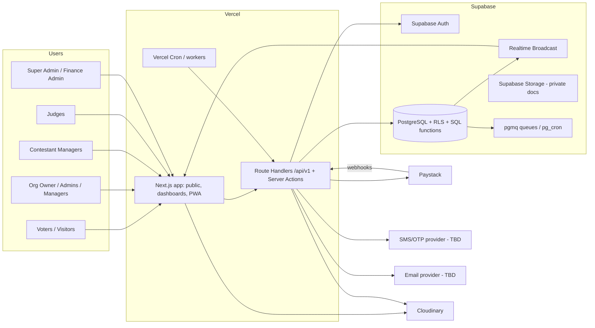
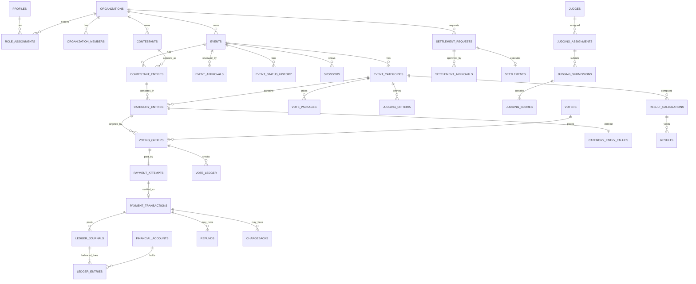

# TekVotes Technical Architecture Specification (TAS) v1.0 — Part 1 of 3
**Foundation, Risks, Architecture, ERD, Schema, Tenant Isolation** (TAS sections 1–5)

Status: **DRAFT FOR PRODUCT-OWNER REVIEW. No code. Not approved.**
Source baseline: *TekVotes Master Project Handoff v1.0* (56 decisions, OD-01…OD-20).

Labels used throughout: **[C]** confirmed requirement · **[R]** technical recommendation · **[A]** assumption · **[U]** unresolved decision (needs owner) · **[V]** external fact to verify.

Parts: Part 1 (this) · [Part 2](file:///C:/Users/Mac-Felix/.gemini/antigravity/brain/c8c783b0-b374-43e9-8dea-1725a0b5e7b4/TAS_v1.0_Part2_Security_Voting_Finance.md) · [Part 3](file:///C:/Users/Mac-Felix/.gemini/antigravity/brain/c8c783b0-b374-43e9-8dea-1725a0b5e7b4/TAS_v1.0_Part3_Workflows_API_Ops.md)

---

## 0. Confirmed baseline and highest-risk unresolved items

### 0.1 Baseline
All 56 decisions are treated as fixed. Traceability to TAS sections is in Part 3, Appendix A. Where I found tension between decisions I did **not** resolve it silently; see 0.3.

### 0.2 Top launch-blocking risks & newly resolved architectural decisions

| # | Item | Status / Confirmed Ruling | Ref |
|---|------|---------------------------|-----|
| 1 | **Payment Collection Model (OD-07)** | **[C]** Proceed with **Option A: Central TekVotes Paystack collection + delayed payout** after Finance Admin and Super Admin approvals. **[V]** Must still obtain written Paystack & Ghana legal/regulatory verification before production financial launch. | OD-07 |
| 2 | **Commission & Fee-Bearer Policy (OD-01, OD-02)** | **[C]** **Pass Paystack processing fee as a transparent surcharge to the Voter; calculate TekVotes commission on the base vote amount** (`snapshot_base_amount_minor`), using Half-Up integer rounding. Default rate bps configured by Super Admin in `commission_rules`. | OD-01/02 |
| 3 | **Late Payment Race Condition (ND-01)** | **[C]** **3-minute grace window after scheduled close**: if an order was initiated *before* `voting_closes_at` and payment succeeds within 180 seconds of `voting_closes_at` (configurable per event, default 180s), votes are credited. If voting was manually **paused**, **cancelled**, or a **hard voting limit** was breached, block vote credit (`paid_uncredited`) and queue for refund/review. | ND-01 |
| 4 | **Voter Phone OTP Cadence (OD-06, ND-05)** | **[C]** **Guest OTP verified once per guest session** (24h encrypted `httpOnly` cookie) with step-up OTP on high-risk fraud signals; **Registered voters verify phone once at signup**. | OD-06/ND-05 |
| 5 | **Live Leaderboard Visibility (OD-11, ND-06)** | **[C]** `results_state` is per category; when `Live`, visibility mode is **configurable per category by the Organizer** (`counts` default, `ranks_only`, or `percent`). | OD-11/ND-06 |
| 6 | **Judging Formula & Post-Final Corrections (OD-12, OD-13)** | **[C]** Normalize public votes (`% of category total votes × 100`) and judge scores (`0–100` scale) before applying weights; tie-break by (1) higher public votes, (2) higher judge score, (3) manual committee decision; missing required judge scores block finalization unless excused. Reopening/correcting `Final` results requires **dual approval (Org Owner + Super Admin)** with a mandatory public correction notice. | OD-12/13 |
| 7 | **Public Event Preview Before Approval (OD-14, ND-07)** | **[C]** Organizers **can** publish "Coming Soon" event and contestant pages before Super Admin approves the event, while the Vote button and checkout remain strictly locked until `approval_status = 'approved'` (Q48). | OD-14/ND-07 |
| 8 | **Refund Fee Treatment (OD-08, OD-09)** | **[C]** Approved refunds reverse credited votes (`vote_ledger` reversal), deduct the organizer's net base share from organizer balance, and reverse TekVotes commission proportionally; the non-refundable Paystack surcharge is not returned (or is borne per refund policy). | OD-08/09 |

### 0.3 Additional architectural rulings locked in v1.0

| ID | Topic | Confirmed Specification in TAS v1.0 |
|----|-------|-------------------------------------|
| ND-01 | Late payment after close/pause/limit | **Confirmed**: 180s grace window after scheduled `voting_closes_at` for orders created before close; strict block (`paid_uncredited`) if paused, cancelled, or limit reached. |
| ND-02 | Contestant identity reuse scope (Q6) | **Confirmed [R]**: Reusable contestant identities are **scoped per organization** (`contestants.organization_id`) to preserve tenant isolation and data privacy. |
| ND-03 | Contestant manager scope (Q35) | **Confirmed [R]**: Contestant managers are assigned **per event entry** (`contestant_entries.id`). |
| ND-04 | Admin control of financial dashboards (Q13) | Enforced via `organizations.finance_access_enabled` (Super Admin toggle) + `organization.finance.view` permission. |
| ND-05 | Guest vs. Registered OTP (Q20, Q31) | **Confirmed**: Guest OTP once per 24h session (+ step-up on risk); Registered voters verify once at signup. |
| ND-06 | Result state scope (Q25, Q37) | **Confirmed**: `results_state` (`hidden`, `live`, `final`) and `live_visibility` (`counts`, `ranks_only`, `percent`) are stored per `event_categories` row. |
| ND-07 | Public preview vs. voting approval (Q48, OD-14) | **Confirmed**: `publication_status = 'published'` exposes public "Coming Soon" pages; `approval_status = 'approved'` is required to enable voting (`voting_status = 'active'`). |
| ND-08 | Peak load sizing | Designed for finale spikes via CDN-cached `leaderboard_snapshots`, async webhook queues, and optional 16-way tally sharding (§24). |
| ND-09 | Separation of duties on withdrawals (Q28) | DB trigger enforces `finance_approver ≠ super_admin_approver ≠ requester`. |
| ND-10 | Third-party SMS/media cost controls (Q56) | Covered by platform commission with per-IP/phone OTP budgets and signed upload limits. |
| ND-11 | Reopening archived events / Final results (Q19, OD-13) | **Confirmed**: Dual approval (Org Owner + Super Admin) + mandatory reason and public correction notice. |
| ND-12 | Duplicate questions in handoff (Q18/29, Q25/37) | Consolidated cleanly. |

---

## 1. Architecture overview

### 1.1 Style [R]
**Modular monolith** (Next.js app + Postgres/Supabase). Domain modules are TypeScript packages with a public service interface; modules never read each other's tables directly except through that interface (enforced by lint rule/dependency-cruiser). Money, votes, results = trusted server code + Postgres functions.

### 1.2 Context diagram



### 1.3 Trust zones
1. **Browser** – untrusted. May read via Supabase anon/authenticated key **only** from RLS-protected, read-oriented objects. Never writes money/votes/results.
2. **Next.js server (service role)** – trusted; every handler performs authz (permission + scope) *before* calling a DB function. Service-role key exists only in server env.
3. **Postgres** – final authority: constraints, RLS, immutability triggers, and `SECURITY DEFINER` functions for critical state changes.
4. **Third parties** – Paystack (verified by HMAC and re-verified by API call), SMS, email, Cloudinary.

### 1.4 Mutation policy [R]
- `authenticated`/`anon` roles: **SELECT only** (policy-filtered). `INSERT/UPDATE/DELETE` revoked on all tables by default.
- All writes go through server code using the service role, calling narrowly-scoped SQL functions (`app_*`/`fin_*`) for anything involving money, votes, scores, approvals, role changes. `EXECUTE` on those functions revoked from `PUBLIC/anon/authenticated`.
- This avoids RLS write-policy complexity on sensitive tables while RLS still protects every read path and acts as defence-in-depth if a client key is abused.

### 1.5 Application areas

| Area | Route group | Audience |
|------|-------------|----------|
| Public site | `/`, `/e/...`, `/o/...` | Visitors, voters |
| Voter account | `/me/...` | Registered voters |
| Organization console | `/org/[orgSlug]/...` | Owner, Org Admin, Event Mgr |
| Contestant-manager portal | `/manage/...` | Contestant Managers |
| Judge portal | `/judge/...` | Judges |
| Platform admin | `/admin/...` | Super/Finance Admin |
| API | `/api/v1/...`, `/api/webhooks/...` | Clients, providers |

### 1.6 Module boundaries (Q16)

| Module | Owns tables (prefix) | Exposes | Depends on |
|--------|----------------------|---------|------------|
| iam | profiles, platform_staff, roles, permissions, role_assignments | `can()`, grant/revoke | — |
| orgs | organizations, applications, members, invitations | org lifecycle | iam, audit |
| events | events, categories, status history, approvals, branding, sponsors | event state machine | orgs, iam |
| contestants | contestants, entries, category_entries, media, social, managers | entry CRUD | events, iam |
| voting | vote_packages, voting_orders, vote_ledger, tallies, limits, voters, otp | `createOrder`, `creditOrder` | events, contestants, payments |
| payments | payment_attempts, payment_transactions, webhooks | provider abstraction | voting, accounting |
| accounting | financial_accounts, journals, entries, commission, refunds, chargebacks, settlements, reconciliation | posting API | payments |
| judging | judges, assignments, criteria, submissions, scores | submit/lock | events, contestants |
| results | scoring_rule_versions, calculations, results, snapshots | compute/publish | voting, judging |
| notifications | notifications, preferences, templates, outbox | send | all (events) |
| moderation | reports, fraud signals/flags | triage | voting |
| reporting | export_jobs | export | all (read-only) |
| domains | domains, slug history | host resolve | events, orgs |
| audit | audit_logs, idempotency_records | `audit()` | all |

---

## 2. Entity-relationship model



Key relational invariants:
- `organization_id` is **denormalised onto every event-scoped table** and enforced with composite FKs `(event_id, organization_id) → events(id, organization_id)`. This makes cross-tenant mix-ups impossible at DB level and keeps RLS cheap.
- A `category_entries` row ties together `(event_id, category_id, entry_id)` with composite FKs ensuring the entry and category belong to the same event.
- A `voting_orders` row references exactly one `category_entries` row — the "one contestant, one category per transaction" rule **[C Q32]** is structural (single FK, no line-items table).

---

## 3. PostgreSQL schema proposal

### 3.1 Conventions [R]
- PK `id uuid default gen_random_uuid()`. Public-facing references use separate `public_code text` (short, non-guessable, e.g. 10–12 base32 chars) so internal UUIDs are not exposed.
- Timestamps `timestamptz` in UTC. Events store `timezone text` (IANA) for display and schedule entry. `created_at`, `updated_at` (trigger) on mutable tables.
- **Money**: `amount_minor bigint` + `currency char(3) references currencies(code)`. `currencies(code, minor_unit_exponent, enabled)`. GHS exponent 2. No floats/`numeric` for money. Rates stored as **basis points** `integer` (1 bp = 0.01%); fractional-bp need **[U]**.
- Enums: Postgres `enum` types for stable state machines; `text + check` for lists likely to evolve (event_type, notification kinds).
- Soft delete: `deleted_at timestamptz` only on user-content tables (contestants, media, sponsors). Never on financial/vote/audit tables.
- Deletion rules: `ON DELETE RESTRICT` default; `CASCADE` only for pure child data with no audit value (e.g. `contestant_social_links`). Personal-data erasure is by **anonymisation**, not row delete, where records must remain (OD-18).
- Every table has RLS **enabled** (even if no policy → deny). Names below are schema-qualified conceptually; proposal: `public` (RLS-read), `private` (helper functions), `fin` (financial, no direct client grants).

### 3.2 Enums

```
org_status:        pending | approved | rejected | suspended
event_approval:    not_submitted | submitted | under_review | approved | rejected | revoked
event_publication: unpublished | published | archived
event_voting:      not_started | active | paused | closed | cancelled
results_state:     hidden | live | final            -- per category
order_status:      pending | payment_initiated | paid_uncredited | credited | failed | expired | reversed
payment_status:    initiated | pending | success | failed | abandoned | reversed | disputed
refund_status:     requested | under_review | approved | rejected | processing | completed | failed
settlement_status: requested | under_finance_review | finance_approved | super_admin_approved
                   | payout_initiated | payout_processing | completed | failed | rejected | cancelled
ledger_entry_type: credit | reversal | correction                                (vote ledger)
```

### 3.3 Identity and access

| Table | Columns (type, null) | Keys / constraints / indexes |
|-------|---------------------|------------------------------|
| `profiles` | id uuid NN (= auth.users.id), display_name text NN, email citext, phone_e164 text, avatar_public_id text, locale text, status text NN default 'active', created_at, deleted_at | PK id FK auth.users ON DELETE RESTRICT; unique(lower(email)) where not null; unique(phone_e164) where not null; check phone ~ '^\+[1-9][0-9]{7,14}$' |
| `platform_staff` | user_id uuid NN, platform_role enum(super_admin, finance_admin) NN, granted_by uuid, granted_at, revoked_at | PK(user_id, platform_role); partial unique on active rows; changes only via audited function |
| `permissions` | key text PK, scope_level enum(platform, organization, event, category, entry) NN, is_financial bool NN, description | seeded by migration; never edited at runtime |
| `role_templates` | id, key text unique NN, name, scope_level NN, is_system bool, organization_id uuid null | org-specific custom templates have organization_id (FK) |
| `role_template_permissions` | role_template_id, permission_key | PK both; FKs |
| `role_assignments` | id, user_id NN, role_template_id NN, organization_id NN, event_id null, category_id null, entry_id null, status text NN ('active','revoked','expired'), can_delegate bool NN default false, granted_by NN, granted_at, expires_at, revoked_at, revoked_by | CHECK scope-columns coherent (`entry_id IS NOT NULL ⇒ event_id IS NOT NULL`, `category_id IS NOT NULL ⇒ event_id IS NOT NULL`); composite FKs `(event_id, organization_id)`, `(category_id, event_id, organization_id)`, `(entry_id, event_id, organization_id)`; unique(user_id, role_template_id, organization_id, coalesce(event_id, '00000000-0000-0000-0000-000000000000'::uuid), coalesce(category_id, '00000000-0000-0000-0000-000000000000'::uuid), coalesce(entry_id, '00000000-0000-0000-0000-000000000000'::uuid)) where status='active'; index(user_id, status), index(organization_id, event_id) |
| `role_assignment_overrides` | assignment_id, permission_key, effect ('grant'/'deny') | PK(assignment_id, permission_key) |

Effective permissions of a user for a resource = ∪ (template ∪ grants − denies) over **active** assignments whose scope **contains** the resource (org ⊇ event ⊇ category/entry). Platform staff are not tenant members; they act through `/admin` with platform permissions. **Org membership never implies platform privilege [C]**.

Delegation guard **[R]**: `grant_role()` function rejects if grantor lacks `iam.roles.delegate` in that scope, or tries to grant a permission the grantor does not hold (no escalation), or grants any `is_financial` permission unless grantor is Owner/platform staff.

### 3.4 Organizations

| Table | Key columns | Constraints |
|-------|-------------|-------------|
| `organization_applications` | id, applicant_user_id null, applicant_name, applicant_email, applicant_phone, org_name, org_type, description, website, country default 'GH', documents jsonb (Storage paths), status enum(pending, approved, rejected, withdrawn), reviewed_by, reviewed_at, rejection_reason, created_at | check: rejected ⇒ reason NN; index(status, created_at) |
| `organizations` | id, application_id unique, slug citext unique NN, name, status org_status, owner_user_id NN, default_currency char(3) default 'GHS', finance_access_enabled bool default false, logo_public_id, contact_email/phone, created_at | slug regex + reserved list check (table `reserved_slugs`) |
| `organization_members` | org_id, user_id, is_owner bool, status, joined_at | PK(org_id, user_id); partial unique: exactly one owner per org (**ownership transfer** via function) |
| `organization_invitations` | id, org_id, email, role_template_id, scope columns, token_hash NN, expires_at NN, accepted_at, revoked_at, invited_by | store hash of token only; unique(token_hash) |

Platform-level: `platform_settings(key, value jsonb, version, updated_by)` (default commission key lives in `commission_rules`, not here).

### 3.5 Events, categories, pricing

`events`
| Column | Type | Null | Notes |
|--------|------|------|-------|
| id | uuid | NN | PK; unique(id, organization_id) |
| organization_id | uuid | NN | FK RESTRICT |
| slug | citext | NN | unique(organization_id, slug) |
| name, description, rules_text | text | NN/null | rules sanitized rich text |
| event_type | text | NN | check in list; templates **[U OD-20]** |
| venue, contact_email, contact_phone | text | null | |
| event_date | timestamptz | null | |
| timezone | text | NN | IANA |
| currency | char(3) | NN | FK currencies |
| voting_opens_at, voting_closes_at | timestamptz | null | check closes > opens |
| approval_status | event_approval | NN | default not_submitted |
| publication_status | event_publication | NN | default unpublished |
| voting_status | event_voting | NN | default not_started |
| pause_reason, paused_at | text, timestamptz | null | current pause (history in status_history) |
| cancelled_at, cancel_reason | | null | |
| branding jsonb → separate `branding_settings` | | | validated tokens |
| duplicated_from_event_id | uuid | null | FK events |
| public_code | text | NN | unique |
| created_by, created_at, updated_at, archived_at | | | |

DB guards: trigger forbids `voting_status → active` unless `approval_status='approved'` **[C Q48]**; trigger forbids changing currency once any order exists.

`event_status_history(id, event_id, organization_id, dimension text ('approval'|'publication'|'voting'|'results'), from_status, to_status, reason, actor_id, actor_kind, created_at)` — insert-only.
`event_approvals(id, event_id, organization_id, submitted_by, submitted_at, reviewer_id, decision, decision_reason, decided_at)`.
`event_categories(id, event_id, organization_id, name, slug [unique per event], description, sort_order, results_state results_state NN default 'hidden', live_visibility text check in ('ranks_only','counts','percent') [U OD-11], voting_enabled bool, scoring_mode text check in ('public','judges','public_plus_judges','weighted'), active_scoring_rule_version_id, unit_price_minor bigint NN check >0, currency, min_votes int, max_votes int [U OD-03], sponsor_id null)`; unique(id, event_id, organization_id); unique(id, event_id); unique(id, organization_id).
`vote_packages(id, category_id, event_id, organization_id, label, votes int NN check >0, price_minor bigint NN check >0, currency, sort_order, active, valid_from, valid_until)` — fixed packages [C Q7, Q22, Q40]. Custom amount: `votes = amount_minor / unit_price_minor` **only if** `amount_minor % unit_price_minor = 0` else reject **[C Q33]** (never round or truncate).
`sponsors(id, event_id, organization_id, name, logo_public_id, banner_public_id, website_url, description, tier, sort_order, sponsored_category_id null)`.
`branding_settings(event_id PK, organization_id, primary_color, accent_color, font_key, logo/banner public_ids, card_style, custom_css **not allowed**)` — enumerated tokens only.
`event_voting_limits(id, event_id, organization_id, category_id null, scope_dimension text check in ('phone','account','device','ip','contestant','category','event'), window_seconds int null, max_votes int null, max_orders int null, max_amount_minor bigint null, enforcement text ('block','flag'))` — rule rows; **dimensions and defaults [U OD-05]**; device/IP rules support `flag` so they are risk signals, not sole controls **[C]**.

### 3.6 Contestants and entries

- `contestants(id, organization_id, display_name, legal_name null, gender null?, date_of_birth null [only if justified, OD-18], bio, profile_public_id, status, deleted_at, created_by)` — **[R ND-02]** org-scoped; unique(id, organization_id).
- `contestant_media(id, contestant_id, organization_id, entry_id null, kind enum(image, video_link), cloudinary_public_id, sort_order, moderation_status, deleted_at)`.
- `contestant_social_links(id, contestant_id, platform text check in list, url text NN check https, sort_order)` [Q53]; url validated server-side, rendered `rel="nofollow noopener"`.
- `contestant_entries(id, event_id, organization_id, contestant_id, contestant_number int NN, public_code text NN unique, event_bio, status ('draft','pending','approved','withdrawn','disqualified','removed'), disqualified_reason, qr_asset_public_id null, registered_by)`: unique(id, event_id, organization_id); unique(event_id, contestant_number); unique(event_id, contestant_id); composite FK (contestant_id, organization_id) → contestants(id, organization_id).
- `category_entries(id, event_id, organization_id, category_id, entry_id, status ('active','withdrawn','disqualified'), display_order)`: unique(id, category_id, event_id, organization_id); unique(category_id, entry_id); composite FKs `(category_id, event_id, organization_id) → event_categories` and `(entry_id, event_id, organization_id) → contestant_entries` enforce same event and tenant.
- `contestant_managers(id, entry_id, event_id, organization_id, user_id, assigned_by, assigned_at, revoked_at)` — convenience projection View over `role_assignments` with template `contestant_manager` (single source of truth is `role_assignments`) **[R]**.

### 3.7 Voting

- `voters(id, user_id null (registered), phone_e164 null, phone_verified_at, email null, marketing_consent …, created_at)`: unique(user_id) where not null; unique(phone_e164) where phone_verified_at is not null. Guest = voter row without `user_id`; if a guest later registers with the same verified phone, `claim_voter_profile()` links `user_id` so prior guest voting history appears in their dashboard.
- `voter_otp_challenges(id, phone_e164, code_hash, purpose, attempts int, max_attempts int, expires_at, consumed_at, ip_hash, device_hash, created_at)` — store hash only; short TTL; attempt cap **[values U OD-06]**.
- `voter_sessions(id, voter_id, token_hash, expires_at, ip_hash, device_hash)` for guest sessions (httpOnly cookie).
- `voter_favourites(voter_id, contestant_entry_id)` [Q34].
- `voting_orders`

| Column | Type | Null | Notes |
|--------|------|------|-------|
| id | uuid | NN | |
| reference | text | NN | unique; **our** reference, sent to Paystack as the transaction reference |
| organization_id, event_id, category_id, category_entry_id | uuid | NN | composite FK `(category_entry_id, category_id, event_id, organization_id) → category_entries` |
| voter_id | uuid | NN | |
| status | order_status | NN | |
| `snapshot_unit_price_minor, snapshot_votes` | bigint | NN | immutable after insert (trigger) |
| `snapshot_base_amount_minor` | bigint | NN | base vote price before voter surcharge (`snapshot_votes * snapshot_unit_price_minor` for custom, or `package.price_minor` for package) |
| `snapshot_surcharge_minor` | bigint | NN | transparent payment-processing surcharge passed to voter (`>= 0`) |
| `snapshot_amount_minor` | bigint | NN | total charged to voter at Paystack (`snapshot_base_amount_minor + snapshot_surcharge_minor`) |
| `snapshot_currency` | char(3) | NN | |
| `snapshot_package_id` | uuid | null | null for custom amount |
| `pricing_mode` | text | NN | 'package'/'custom' |
| `commission_rule_id, commission_bps` | uuid, int | NN | snapshotted at order creation from active rule (calculated on `snapshot_base_amount_minor`) |
| `fee_bearer_snapshot` | text | NN | default `'voter'` per confirmed OD-01 ruling |
| `risk_score, risk_signals jsonb` | | null | risk, not proof |
| `expires_at` | timestamptz | NN | pending order TTL (default 15m) |
| `client_ip_hash, device_hash, user_agent_hash` | text | null | hashed with rotating salt; retention OD-18 |
| `created_at, credited_at` | | | |
CHECK: `snapshot_votes > 0 AND snapshot_base_amount_minor > 0 AND snapshot_surcharge_minor >= 0 AND snapshot_amount_minor = snapshot_base_amount_minor + snapshot_surcharge_minor AND ((pricing_mode = 'custom' AND snapshot_package_id IS NULL AND snapshot_base_amount_minor = snapshot_votes * snapshot_unit_price_minor) OR (pricing_mode = 'package' AND snapshot_package_id IS NOT NULL))` — guarantees exact integer whole-vote math on the base vote amount while transparently recording the voter surcharge. Index(category_entry_id, status), (voter_id, created_at), (event_id, created_at).
- `vote_ledger` **(append-only)**: id, event_id, organization_id, category_id, category_entry_id, entry_type ledger_entry_type, votes int NN (+credit / −reversal; correction signed), order_id null FK, reverses_ledger_id null FK, reason text (NN for non-credit), approved_by (NN for correction), actor_id, created_at, idempotency_key text NN unique. Unique partial index: `(order_id) WHERE entry_type='credit'` → at most one credit per order; unique partial index: `(reverses_ledger_id) WHERE entry_type='reversal' AND votes = (SELECT -votes FROM vote_ledger orig WHERE orig.id = reverses_ledger_id)` + check that cumulative reversals for a `reverses_ledger_id` never exceed the original credit's `votes`. Check: `entry_type='credit' ⇒ votes>0 AND order_id NN`; `reversal ⇒ reverses_ledger_id NN AND votes<0`.
- `category_entry_tallies` (derived, rebuildable): category_entry_id PK, category_id, event_id, organization_id, total_votes bigint NN check >= 0, last_ledger_id, updated_at. Updated **only** inside the credit/reversal/correction functions; nightly + on-demand `verify_tallies()` compares against `SUM(vote_ledger)`.
- `leaderboard_snapshots(id, category_id, event_id, organization_id, results_state, visibility_mode, payload jsonb [rank, entry_id, display fields, votes only if mode allows], source_ledger_max_id, calc_id null, published bool, created_at)` — the **only** thing public clients/Realtime may read for leaderboards.

### 3.8 Payments and finance (`fin` schema, no client grants)

- `payment_attempts(id, order_id unique, provider text NN default 'paystack', provider_reference text NN, access_code, authorization_url, channel null, status payment_status, amount_minor, currency, initiated_at, last_checked_at)`; unique(provider, provider_reference).
- `payment_transactions(id, attempt_id unique, order_id unique, provider, provider_txn_id text NN, provider_reference, amount_minor, currency, provider_fee_minor null, paid_at, channel, raw_verification jsonb, status, verified_at)`; **unique(provider, provider_txn_id)** — core idempotency.
- `payment_webhooks(id, provider, event_type, dedupe_key text NN, signature_valid bool, payload jsonb, raw_body_sha256, received_at, processed_at, process_status ('received','processing','done','ignored','error'), error text, attempts int)`; unique(provider, dedupe_key) where dedupe_key = provider event id if present else `sha256(event_type|reference|raw_body)` **[V Paystack event identifiers]**.
- `currencies`, `exchange_rates` (future, OD-17; unused at launch).
- `financial_accounts(id, code text unique, type enum(asset, liability, equity, revenue, expense), organization_id null, event_id null, currency, owner_kind ('platform','organization'), name, active)` — per-org liability accounts created at approval; unique(code).
- `ledger_journals(id, journal_type text, source_type text, source_id uuid, currency, description, effective_at, created_at, idempotency_key NN unique, reverses_journal_id null, posted_by)` — immutable.
- `ledger_entries(id, journal_id, account_id, organization_id null, event_id null, direction ('debit'/'credit'), amount_minor bigint NN check >0, currency, created_at)` — immutable. **Fund-tracking dimensions [C owner ruling]:** every entry touching an organization liability account **must** carry `organization_id` and `event_id` (check constraint), so the platform keeps a permanent fund record **per event** and **per organization** (org = sum of its events). Composite FK `(event_id, organization_id) → events`. Views: `v_event_funds` (per event: gross collected, surcharges, provider fees, commission, organizer share, refunds, chargebacks, held, released, paid out) and `v_org_funds` (rollup). Both reconcile to the same ledger, so no second source of truth; **`CREATE CONSTRAINT TRIGGER trg_journal_balanced AFTER INSERT ON fin.ledger_entries DEFERRABLE INITIALLY DEFERRED FOR EACH ROW EXECUTE FUNCTION fin.assert_journal_balanced()`** verifies at transaction commit that every touched `journal_id` has `COUNT(*) >= 2`, `SUM(debit) = SUM(credit)`, and all entries match `ledger_journals.currency` and `financial_accounts.currency`.
- `commission_rules(id, scope ('platform_default','organization'), organization_id null, rate_bps int NN check 0..10000, basis enum('gross','net_of_provider_fee'), rounding enum('half_up','half_even','floor','ceil'), fee_bearer enum('platform','organizer','voter'), valid_from, valid_to null, status ('draft','pending_approval','active','retired'), proposed_by, approved_by, created_at)` — **no default values are seeded**; exclusion constraint prevents overlapping active ranges per scope **[U OD-01/02]**.
- `commission_entries(id, order_id unique, payment_txn_id, rule_id, rate_bps, basis, rounding, gross_minor, provider_fee_minor, commission_base_minor, commission_minor, organizer_net_minor, journal_id)` — the persisted calculation [C acceptance criterion].
- `refunds(id, payment_txn_id, order_id, org_id, requested_by, requester_kind, reason, status, amount_minor, partial bool, investigation_notes, approved_by, approved_at, provider_refund_id, vote_reversal_ledger_id, journal_id, created_at)`.
- `chargebacks(id, payment_txn_id, provider_dispute_id unique, status, amount_minor, opened_at, evidence_due_at, resolved_at, outcome, vote_reversal_ledger_id, journal_id)` **[V provider dispute webhooks]**.
- `settlement_requests(id, org_id, requested_by, amount_minor, currency, destination_id, status, created_at, …)` + `settlement_request_items(request_id, event_id, amount_minor)` (a request is made up of per-event amounts; **only events whose voting is `closed` are eligible**, amounts sum to the request, each ≤ that event's available balance) — **[C owner ruling: payouts happen after the voting event ends]**; `settlement_destinations(id, org_id, type ('mobile_money','bank'), provider_recipient_code, masked_account, account_name, verified_at, verified_by, status)`; `settlement_approvals(id, request_id, stage ('finance','super_admin'), approver_id, decision, comment, created_at)` with unique(request_id, stage) and trigger: approver ≠ requester, finance approver ≠ super-admin approver; `settlements(id, request_id unique, provider_transfer_ref unique, status, initiated_at, completed_at, failure_reason, journal_id)`.
- `reconciliation_runs(id, provider, period_start, period_end, status, matched_count, mismatched_count, report jsonb, run_by, created_at)`; `reconciliation_items(run_id, payment_txn_id null, provider_ref, kind ('missing_local','missing_provider','amount_mismatch','status_mismatch'), resolved_by, resolved_at)`.
- `org_balances` is **not a table**: a view over `ledger_entries` per account (pending, available, reserved, in-flight) **[R]** to avoid a second source of truth; materialised view for dashboards.

### 3.9 Judging and results
- `judges(id, user_id NN, org_id, display_name, public_alias null, anonymous_public bool)`.
- `judging_assignments(id, judge_id, event_id, category_id, org_id, assigned_by, revoked_at)`; unique(judge_id, category_id).
- `judging_criteria(id, category_id, event_id, org_id, name, description, weight_bps int NN, min_score numeric(10,4), max_score numeric(10,4), step numeric, required bool, sort_order)`; trigger on category lock: `SUM(weight_bps)` = 10000 (or intended total) before judging opens **[Q26]**.
- `judging_submissions(id, assignment_id, category_entry_id, status ('draft','submitted','superseded'), submitted_at, locked_at, version int, supersedes_id null, correction_reason, correction_approved_by)`; unique(assignment_id, category_entry_id) where status='submitted'.
- `judging_scores(id, submission_id, criterion_id, score numeric(10,4) NN)` — insert-only once the parent is submitted (trigger); corrections = new submission version.
- `scoring_rule_versions(id, category_id, version int, definition jsonb (validated JSON schema), definition_sha256, created_by, approved_by, effective_at, status)` — immutable once used; unique(category_id, version).
- `result_calculations(id, category_id, rule_version_id, input_snapshot jsonb or reference to snapshot rows, input_sha256, computed_at, computed_by, engine_version, status ('draft','verified','published','superseded'))`.
- `results(id, calculation_id, category_entry_id, rank int, final_score numeric(18,6), components jsonb, tie_break_trace jsonb, disqualified bool)`.
- `result_publications(id, category_id, calculation_id, state results_state, published_by, approved_by, published_at, correction_notice null, supersedes_id)` — insert-only.

### 3.10 Operations
`notifications(id, user_id|voter_id|recipient addr, channel, kind, payload, status, provider_msg_id, attempts, scheduled_at, sent_at)` · `notification_preferences(owner, channel, kind, opted_in, updated_at, consent_source)` · `notification_templates` · `announcements(id, event_id, org_id, audience_filter, body, status, approved_by null)` · `moderation_reports(id, reporter_voter_id|user_id|ip_hash, target_type, target_id, category, description, evidence jsonb, status, assigned_to, resolution, created_at)` · `fraud_flags(id, scope refs, signal_kind, score, evidence jsonb, status, reviewed_by)` · `audit_logs(id, at, actor_id, actor_kind, action, resource_type, resource_id, organization_id, event_id, before jsonb, after jsonb, reason, ip_hash, request_id)` — insert-only, partitioned by month · `export_jobs(id, requested_by, kind, params, format, status, storage_path, expires_at, row_count, created_at)` · `export_audit` folded into audit_logs · `idempotency_records(scope, key, request_hash, response jsonb, status, created_at, expires_at)` PK(scope,key) · `domains(id, org_id, event_id null, hostname citext unique, kind, verification_token, verified_at, ssl_status, status)` · `slug_history(entity, old_slug, entity_id, org_id)` · `reserved_slugs(slug)`.

### 3.11 Index plan (highlights)
- Leaderboard: `category_entry_tallies(category_id, total_votes DESC)`.
- Payment lookup: unique `(provider, provider_reference)`, `(provider, provider_txn_id)`.
- Tenant filters: `(organization_id, …)` leading column on every event-scoped table, plus `(event_id, …)`.
- Reports: `vote_ledger(event_id, created_at)`, `ledger_entries(account_id, created_at)`, `voting_orders(event_id, status, created_at)`.
- Audit: BRIN on `audit_logs(at)`, btree `(organization_id, at)`.
- Webhook backlog: partial index `payment_webhooks(received_at) WHERE process_status IN ('received','error')`.

### 3.12 Immutability enforcement (defence in depth)
For `vote_ledger`, `ledger_journals`, `ledger_entries`, `audit_logs`, `event_status_history`, `result_publications`, `judging_scores`(post-submit), `payment_transactions`(core columns): (1) `REVOKE UPDATE, DELETE` from all app roles, (2) `BEFORE UPDATE OR DELETE` trigger raising exception (also for service role), (3) corrections by new rows referencing originals. Only a break-glass DBA role (not used by the app, audited externally) can bypass.

---

## 4. Tenant isolation strategy [C Q2, Q17, §3.4]

Three layers, each independently sufficient to stop a cross-tenant read:
1. **Structural**: composite FKs carry `organization_id` down every hierarchy; impossible to attach an event child to a different org.
2. **RLS** (Part 2): every tenant table filtered by `private.has_perm(...)`; helper takes explicit org/event/category/entry arguments.
3. **Server authz**: handler resolves resource → its org/event → checks permission **before** using service role; `organization_id` is never taken from request bodies, only derived from the resource row.

Scope hierarchy: `platform > organization > event > {category, entry}`.

| Actor | Sees |
|-------|------|
| Org Owner | everything inside own org (financial subject to ND-04) |
| Org Admin | only permissions explicitly granted, at org scope |
| Event Manager | assigned events only (assignment scope = event) |
| Contestant Manager | assigned entries only; not siblings [C] |
| Judge | assigned category's contestants/criteria; own scores only; never other judges' scores before finalisation |
| Voter | own orders/receipts |
| Public | published, non-hidden projections only |

Multi-org users: a single user may hold assignments in several orgs; the active org is selected in the URL (`/org/[slug]`) and **re-authorised on each request**, never stored as a global session role. JWT carries no role claims for tenant rights (avoids stale-privilege problems); only `aal`/identity. Optional: a minimal `is_platform_staff` claim cached ≤ 5 min.
