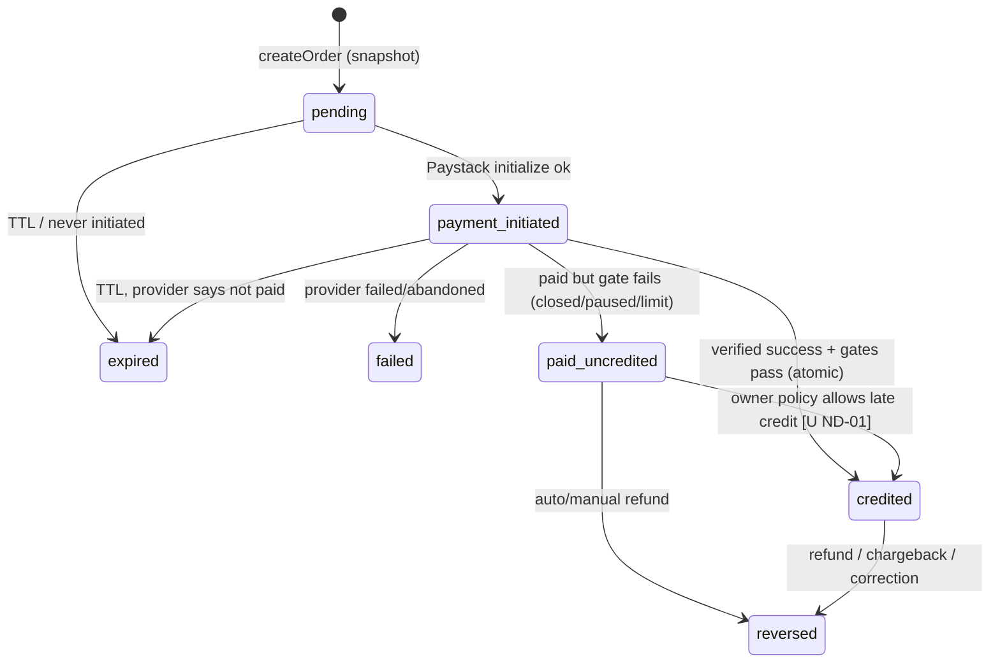
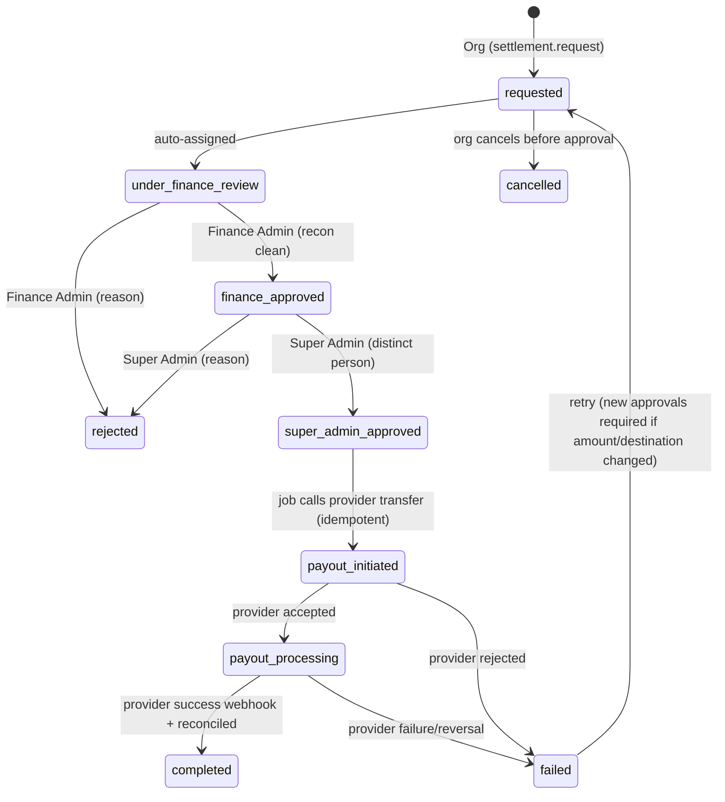

# TekVotes TAS v1.0 — Part 2 of 3
**Permissions, RLS, Auth, Voting, Payments, Ledger, Realtime** (TAS sections 6–14)

Labels: **[C]** confirmed · **[R]** recommendation · **[A]** assumption · **[U]** unresolved · **[V]** to verify externally.
Back: [Part 1](file:///C:/Users/Mac-Felix/.gemini/antigravity/brain/c8c783b0-b374-43e9-8dea-1725a0b5e7b4/TAS_v1.0_Part1_Foundation_and_Schema.md) · Next: [Part 3](file:///C:/Users/Mac-Felix/.gemini/antigravity/brain/c8c783b0-b374-43e9-8dea-1725a0b5e7b4/TAS_v1.0_Part3_Workflows_API_Ops.md)

---

## 6. Role–permission matrix

### 6.1 Permission keys (seed list, extensible only via migration)
Format `domain.resource.action`.

| Domain | Keys |
|--------|------|
| platform | `platform.orgs.review`, `platform.orgs.suspend`, `platform.events.approve`, `platform.commission.manage`, `platform.users.manage`, `platform.staff.manage`, `platform.fraud.manage`, `platform.domains.manage`, `platform.audit.view`, `platform.settings.manage` |
| finance | `finance.payments.view`, `finance.reconcile.run`, `finance.refunds.review`, `finance.refunds.approve`, `finance.settlements.review`, `finance.settlements.approve` (Super Admin stage), `finance.reports.view`, `finance.reports.export` |
| organization | `organization.profile.manage`, `organization.members.manage`, `organization.roles.delegate`, `organization.events.create`, `organization.finance.view`, `settlement.request`, `settlement.destination.manage` |
| event | `event.settings.manage`, `event.submit_for_approval`, `event.publish`, `event.categories.manage`, `event.pricing.manage`, `event.limits.manage`, `event.contestants.register`, `event.contestants.manage`, `event.managers.assign`, `event.sponsors.manage`, `event.branding.manage`, `event.voting.pause`, `event.voting.resume`, `event.voting.close`, `event.cancel.request`, `event.judges.manage`, `event.results.view_internal`, `event.results.publish`, `event.leaderboard.set_state`, `event.announcements.send`, `event.reports.export`, `event.duplicate`, `event.moderation.handle` |
| entry | `entry.profile.edit`, `entry.media.manage`, `entry.social.manage`, `entry.stats.view` |
| judging | `judging.score.submit`, `judging.assigned.view`, `judging.correction.request` |
| voter | `voter.history.view`, `voter.favourites.manage` (self-scope, enforced by ownership not role) |

### 6.2 Default role templates (✔ default, ○ grantable, — never)

| Permission group | Super Admin | Finance Admin | Org Owner | Org Admin | Event Mgr | Contestant Mgr | Judge |
|---|---|---|---|---|---|---|---|
| Review/approve org, approve event [C Q1,48] | ✔ | — | — | — | — | — | — |
| Commission policy [C Q27] | ✔ | — (view) | — | — | — | — | — |
| Refund review | ✔ | ✔ | — | — | — | — | — |
| Refund final approval | ✔ | — **[U: who approves? Q23 says approval only]** | — | — | — | — | — |
| Settlement finance review [C Q28] | ○ | ✔ | — | — | — | — | — |
| Settlement final approval [C Q28] | ✔ | — | — | — | — | — | — |
| Request settlement | — | — | ✔ | ○ (financial: only if Owner grants) | — | — | — |
| Org members/roles | — | — | ✔ | ○ | — | — | — |
| Create events | — | — | ✔ | ○ | — | — | — |
| Event setup, categories, pricing, limits | ✔ (override) | — | ✔ | ○ | ○ (assigned event) | — | — |
| Register contestants [C Q49] | — | — | ✔ | ○ | ○ | — | — |
| Assign contestant managers [C Q35] | — | — | ✔ | ○ | ○ (`event.managers.assign`) | — | — |
| Edit assigned contestant profile/media/social | — | — | ✔ | ○ | ○ | ✔ (assigned entry only) | — |
| Pause/resume/close voting [C Q42, 46] | ✔ | — | ✔ | ○ | ○ | — | — |
| Publish leaderboard / results | ✔ | — | ✔ | ○ | ○ | — | — |
| View org financials | ✔ | ✔ | ✔ (if `finance_access_enabled`) | ○ | — | — | — |
| Submit judging scores | — | — | — | — | — | — | ✔ (assigned category) |
| Exports | scoped by data kind + permission | | | | | | |

Rules **[R]**:
- Financial permissions (`is_financial=true`) are **never** inherited via role defaults for Org Admin; Owner must explicitly grant.
- Super Admin override actions on tenant events are always audit-logged with reason (they bypass nothing silently).
- `Finance Admin ≠ Super Admin` capability: a person holding both roles cannot approve the same settlement twice (§12.3).
- Finance Admin cannot approve their own refund/settlement requests; Super Admin cannot be the settlement requester **and** approver.

### 6.3 Delegation model [C Q3, Q17]
1. Owner invites by email → invitation carries template + scope + optional overrides.
2. `can_delegate` flag allows an Org Admin/Event Manager to assign **within their own scope and subset of own permissions**.
3. Assignments can expire (`expires_at`), are revocable instantly (`revoked_at`); policy lookups require `status='active' AND (expires_at IS NULL OR expires_at>now())`.
4. Every grant/revoke → audit log with before/after.

---

## 7. Supabase RLS strategy

### 7.1 Principles
- RLS on for **all** tables. `anon`/`authenticated` get SELECT grants only on tables/views intended for them. Financial (`fin`), webhook, OTP, ledger-posting tables have **no** client grants at all.
- Policies call `private.has_perm()`; function is `SECURITY DEFINER`, `STABLE`, `SET search_path = ''`, owner is a non-login role, lives in a non-exposed schema.
- Use `(select auth.uid())` form so the planner evaluates once per query **[V Supabase RLS performance guidance]**.
- Public projections are **views with `security_invoker=false`** only where unavoidable, exposing a whitelisted column list and `WHERE published`. Prefer `security_invoker=true` views over RLS-filtered tables.
- Writes: via server functions (service role bypasses RLS, so authz in code is mandatory).

### 7.2 Helper functions (representative SQL)

```sql
-- schema private is not exposed through the Data API
-- Deny overrides take absolute precedence across all active assignments in the scope hierarchy.
create or replace function private.has_perm(
  p_perm text, p_org uuid, p_event uuid default null,
  p_category uuid default null, p_entry uuid default null)
returns boolean
language sql stable security definer set search_path = ''
as $$
  select (
    exists (
      select 1
      from public.role_assignments ra
      left join public.role_template_permissions rtp
        on rtp.role_template_id = ra.role_template_id and rtp.permission_key = p_perm
      left join public.role_assignment_overrides og
        on og.assignment_id = ra.id and og.permission_key = p_perm and og.effect = 'grant'
      where ra.user_id = (select auth.uid())
        and ra.status = 'active'
        and (ra.expires_at is null or ra.expires_at > now())
        and ra.organization_id = p_org
        and (ra.event_id    is null or ra.event_id    = p_event)
        and (ra.category_id is null or ra.category_id = p_category)
        and (ra.entry_id    is null or ra.entry_id    = p_entry)
        and (rtp.permission_key is not null or og.permission_key is not null)
    )
    and not exists (
      select 1
      from public.role_assignments ra
      join public.role_assignment_overrides od
        on od.assignment_id = ra.id and od.permission_key = p_perm and od.effect = 'deny'
      where ra.user_id = (select auth.uid())
        and ra.status = 'active'
        and (ra.expires_at is null or ra.expires_at > now())
        and ra.organization_id = p_org
        and (ra.event_id    is null or ra.event_id    = p_event)
        and (ra.category_id is null or ra.category_id = p_category)
        and (ra.entry_id    is null or ra.entry_id    = p_entry)
    )
  );
$$;

create or replace function private.has_any_event_assignment(p_org uuid, p_event uuid)
returns boolean language sql stable security definer set search_path = ''
as $$
  select exists (
    select 1 from public.role_assignments ra
    where ra.user_id = (select auth.uid())
      and ra.status = 'active'
      and (ra.expires_at is null or ra.expires_at > now())
      and ra.organization_id = p_org
      and (ra.event_id is null or ra.event_id = p_event)
  );
$$;

create or replace function private.is_platform(p_role text default null)
returns boolean language sql stable security definer set search_path = ''
as $$ select exists (select 1 from public.platform_staff s
       where s.user_id = (select auth.uid()) and s.revoked_at is null
         and (p_role is null or s.platform_role::text = p_role)); $$;
```
> Note: when an assignment is event-scoped (`event_id` set) and the target resource is organization-level (`p_event is null`), the `ra.event_id = p_event` test fails → correct: an Event Manager gets no org-level access. Org-scope assignments (all scope columns null) match everything inside the org. And `has_any_event_assignment` lets Contestant Managers or Judges read basic parent-event metadata even while the event is still `unpublished`, without granting them event-management permissions.

### 7.3 Representative policies

```sql
-- events: tenant staff (or assigned entry managers/judges) read; public reads published only
alter table public.events enable row level security;

create policy events_staff_select on public.events for select to authenticated
using ( private.is_platform()
     or private.has_any_event_assignment(organization_id, id) );

create policy events_public_select on public.events for select to anon, authenticated
using ( publication_status = 'published' and approval_status not in ('rejected', 'revoked') );
-- Confirmed OD-14 ruling: Organizers can publish 'Coming Soon' event & contestant pages before Super Admin approves voting,
-- while voting_status='active' and order creation remain strictly gated by approval_status='approved' (Q48).

-- no insert/update/delete policies => denied for client roles; writes go via server.

-- contestant_entries: public sees approved entries of published events; managers see assigned only
create policy entries_public on public.contestant_entries for select to anon, authenticated
using ( status = 'approved' and exists (
  select 1 from public.events e where e.id = event_id and e.publication_status='published'));

create policy entries_staff on public.contestant_entries for select to authenticated
using ( private.has_perm('event.contestants.manage', organization_id, event_id)
     or private.has_perm('entry.profile.edit', organization_id, event_id, null, id)
     or private.has_perm('entry.stats.view', organization_id, event_id, null, id) );

-- vote_ledger: not public. Org staff with stats permission read their own tenant; nobody writes via client
alter table public.vote_ledger enable row level security;
revoke all on public.vote_ledger from anon, authenticated;
grant select on public.vote_ledger to authenticated;
create policy vl_staff_select on public.vote_ledger for select to authenticated
using ( private.is_platform()
     or private.has_perm('event.results.view_internal', organization_id, event_id, category_id)
     or private.has_perm('entry.stats.view', organization_id, event_id, category_id, (
          select ce.entry_id from public.category_entries ce where ce.id = category_entry_id
        )) );

-- leaderboard_snapshots: public sees only published snapshots of non-hidden categories
create policy lb_public on public.leaderboard_snapshots for select to anon, authenticated
using ( published and results_state in ('live','final') );

-- judging_scores: a judge sees/inserts only own; staff never see unfinalised scores individually
create policy js_judge_select on public.judging_scores for select to authenticated
using ( exists (select 1 from public.judging_submissions s
  join public.judging_assignments a on a.id = s.assignment_id
  join public.judges j on j.id = a.judge_id
  where s.id = submission_id and j.user_id = (select auth.uid())) );
-- Inserts happen through fn submit_scores() (server) which locks the submission.

-- role_assignments: user sees own; org owner/admins with members.manage see their org
create policy ra_select on public.role_assignments for select to authenticated
using ( user_id = (select auth.uid())
     or private.has_perm('organization.members.manage', organization_id)
     or private.is_platform() );

-- fin.* : no policies, no grants. Finance UI reads via server using service role
-- after app-level check of finance.* permissions, or via security-definer views
-- exposing org-scoped aggregates with embedded authorization predicate:
create view public.v_org_balances with (security_invoker = false) as
select a.organization_id,
       a.code,
       sum(case e.direction when 'credit' then e.amount_minor else -e.amount_minor end) as balance_minor,
       e.currency
from fin.ledger_entries e
join fin.financial_accounts a on a.id = e.account_id
where a.organization_id is not null
  and (
    private.is_platform('super_admin')
    or private.is_platform('finance_admin')
    or (
      private.has_perm('organization.finance.view', a.organization_id)
      and exists (
        select 1 from public.organizations o
        where o.id = a.organization_id and o.finance_access_enabled = true
      )
    )
  )
group by a.organization_id, a.code, e.currency;
```

### 7.4 What must be server-only (service role) [R]
Payment init and verification; webhook handling; vote crediting; ledger posting; commission calculation; refund/chargeback/settlement transitions; result computation/publication; OTP issue/verify; role grant/revoke; event approval; domain verification; export generation; guest voter reads (guests have no Supabase identity).

### 7.5 RLS test plan (must pass in CI)
A pgTAP/Vitest suite that for each critical table asserts: (a) user of Org A cannot SELECT Org B rows; (b) event manager of Event 1 cannot read Event 2; (c) contestant manager of Entry X cannot read Entry Y; (d) judge cannot read another judge's scores or unassigned category; (e) anon cannot read hidden leaderboards, unpublished events, ledger, financial tables; (f) no role can UPDATE/DELETE ledger tables (including service role via trigger); (g) expired/revoked assignment grants nothing; (h) user with overrides `deny` loses permission. Fuzz: auto-generate cross-tenant probes for every table with `organization_id`.

---

## 8. Authentication, guest voter/OTP, sessions

| Actor | Mechanism |
|-------|-----------|
| Platform staff, org users, judges, contestant managers | Supabase Auth email+password or magic link; **MFA (TOTP) mandatory for Super/Finance Admin and recommended for Owners** **[R]** |
| Registered voter [C Q20] | Supabase Auth (email or phone). Social login optional **[U]** |
| Guest voter [C Q31] | Not a Supabase Auth user. Custom OTP + server-side session |
| Public visitor | none |

### 8.1 Guest OTP flow [Confirmed OD-06 / ND-05]
1. `POST /api/v1/voter/otp/request {phone}` → normalise to E.164; rate limit by phone, IP, device hash; generate 6-digit CSPRNG code; store `code_hash = HMAC(secret, code||challenge_id)`, 5-minute TTL and 5-attempt cap; send via SMS provider.
2. `POST /api/v1/voter/otp/verify {challenge_id, code}` → constant-time compare, increment attempts, on success set `phone_verified_at`, create `voter_sessions` row; return `httpOnly`, `Secure`, `SameSite=Lax` cookie holding opaque random token (DB stores hash).
3. **Confirmed Session Cadence**: Guest OTP is verified **once per guest session (24h cookie TTL)** with step-up OTP triggered only on high-risk fraud signals (e.g., sudden IP/device change or velocity spike). Registered voters verify their phone **once at signup**.
4. Why not Supabase phone auth for guests: it creates `auth.users` for every voter and couples guest voting to a single built-in provider; a dedicated `voter_otp_challenges` + `voter_sessions` layer keeps Ghana SMS provider failover simple.
5. Anti-abuse: SMS-pumping protection (Ghana `+233` default allow-list unless event enables international voting, per-IP and global send budgets, human-solved challenge widget before first OTP send), cost alert.

### 8.2 Session hygiene
Access tokens short-lived (Supabase default **[V]**), refresh rotation, server reads session via `@supabase/ssr`; CSRF: SameSite cookies + origin check on mutating routes; strict CSP; all HTML from users sanitised (allow-list). Admin sessions: shorter idle timeout, re-auth for sensitive actions (settlement approval, role grants, commission change).

---

## 9. Voting order lifecycle and exact transaction algorithm

### 9.1 States


### 9.2 `createOrder` (server, idempotent)
Input: `category_entry_id`, `package_id` **or** `custom_base_amount_minor`, `Idempotency-Key`, voter session.
1. Resolve voter (registered or verified guest with valid 24h session). Reject if not verified.
2. Load category_entry → category → event in one query; check: entry & category active; `event.voting_status='active'`; `approval_status='approved'`; `now()` within `[voting_opens_at, voting_closes_at)` (**time is evaluated in the DB with `now()`, never from client**); category `voting_enabled`.
3. Pricing & Voter Surcharge [Confirmed OD-01]:
   - Package mode → read package (active, within validity) → `votes`, `base_amount_minor = package.price_minor`.
   - Custom mode → require `custom_base_amount_minor % unit_price_minor = 0` **[C Q33]**; `votes = custom_base_amount_minor / unit_price_minor` using integer arithmetic; enforce `min_votes`/`max_votes`. Else HTTP 422 `NOT_WHOLE_VOTES`.
   - Compute transparent voter processing surcharge `snapshot_surcharge_minor` (from configured payment-fee schedule, integer minor units) and `snapshot_amount_minor = snapshot_base_amount_minor + snapshot_surcharge_minor`.
4. Limits: evaluate `event_voting_limits` (block rules) with counts from `voting_orders`/`vote_ledger` in rolling windows; flag-rules add to `risk_signals`.
5. Idempotency: `INSERT … ON CONFLICT (scope,key)`; replay returns stored response.
6. Insert `voting_orders(status='pending', snapshot_*, commission snapshot from active rule at this moment, expires_at = now() + interval '15 minutes')`.
7. Call provider (`initialize`) with `reference = order.reference`, `amount = snapshot_amount_minor`, currency, callback URL, metadata `{order_id}` (metadata is hint, never trusted). Insert `payment_attempts`; set `payment_initiated`. If provider call fails → order `failed`, no vote effect.

### 9.3 `creditOrder(provider_reference)` — exact algorithm
Triggered by webhook processor **or** reconcile poll **or** callback-page poll (all converge to the same function; the browser redirect is only a trigger to *check*, never evidence **[C]**).

```
1. verified = provider.verify(reference)              -- server-to-server call using secret key
   REQUIRE verified.status == 'success'
   REQUIRE verified.currency == order.snapshot_currency
   REQUIRE verified.amount   == order.snapshot_amount_minor   -- integer equality (base + voter surcharge)
   REQUIRE verified.reference == order.reference
   REQUIRE merchant context matches (account/integration id) [V fields]
   ELSE mark attempt failed/flag 'amount_mismatch' + fraud_flag; stop.
2. BEGIN;
3.   SELECT * FROM voting_orders WHERE id=$1 FOR UPDATE;       -- serialises concurrent triggers for same order
4.   IF status='credited' THEN COMMIT; RETURN already_done;     -- idempotent no-op
5.   INSERT payment_transactions(...) ON CONFLICT (provider, provider_txn_id) DO NOTHING;
     IF no row inserted AND order not credited THEN investigate (duplicate txn id w/ different order) -> raise.
6.   Acquire transaction-scoped advisory locks on active hard-limit keys:
        PERFORM pg_advisory_xact_lock(hashtext('lim:voter:' || order.voter_id::text || ':' || order.event_id::text));
        PERFORM pg_advisory_xact_lock(hashtext('lim:entry:' || order.category_entry_id::text));
     Gate re-check using DB now() [Confirmed ND-01 3-Minute Grace Window]:
        REQUIRE approval_status == 'approved'
        REQUIRE entry.status == 'approved' AND category.voting_enabled == true
        REQUIRE voting_status NOT IN ('paused', 'cancelled')
        REQUIRE (voting_status == 'active' AND now() < voting_closes_at)
             OR (order.created_at < voting_closes_at AND now() <= voting_closes_at + interval '180 seconds')
        REQUIRE hard limit rules pass (evaluated under advisory lock)
     IF gate fails THEN order.status='paid_uncredited'; post journal "funds_received_unallocated"
          (Dr A-PROV-CLEAR / Dr X-PROV-FEES / Cr L-SUSPENSE-UNALLOC); enqueue refund-review; COMMIT; RETURN.
7.   Compute commission on base vote amount (Confirmed OD-01, integer math, Half-Up rounding):
        commission = half_up( order.snapshot_base_amount_minor * rate_bps / 10000 )
        organizer_net = order.snapshot_base_amount_minor - commission
8.   INSERT commission_entries (persist rule, rate, basis='base_amount', base=snapshot_base_amount_minor, commission, organizer_net)
9.   POST journal (see §11.3) with idempotency_key = 'credit:'||order_id
10.  INSERT vote_ledger (entry_type='credit', votes=snapshot_votes, order_id, idempotency_key='credit:'||order_id)
        -- partial unique index (order_id) WHERE credit prevents duplicates even if code is wrong
11.  UPSERT category_entry_tallies SET total_votes = total_votes + votes
12.  UPDATE voting_orders SET status='credited', credited_at=now();
13.  INSERT notification outbox (receipt SMS/email/in-app) and audit row;
14. COMMIT;
15. AFTER COMMIT (outbox worker): send receipts, enqueue leaderboard snapshot refresh.
```
Properties: single transaction ⇒ all-or-nothing; `FOR UPDATE` + unique constraints ⇒ at-most-once; receipts leave only after commit via outbox ⇒ no receipt for uncommitted votes **[C 7.5]**. Steps 5–13 are one SQL function `fin.credit_paid_order(order_id, verified_payload jsonb)`; the HTTP verification (step 1) happens outside the DB transaction so no network I/O holds locks.

### 9.4 Limits engine
Rules evaluated by dimension with exact semantic **[U OD-05]**. Recommended default posture: phone/account limits = hard; device/IP = `flag` (risk) unless owner explicitly sets `block`; shared-network false positives (campus Wi-Fi, carrier NAT) are a stated risk **[C 11.3]**.

---

## 10. Paystack integration architecture

> **[V] Every Paystack capability below comes from a web-search summary of Paystack documentation, not from a verified primary reading or from Paystack confirmation.** Before implementation, the team must (a) read the cited official pages directly and (b) obtain written confirmation from Paystack for the merchant arrangement. I do **not** assert that Paystack permits the central-collection model.

### 10.1 Items to verify (checklist for the validation workstream)
| Topic | Indicative (unverified) | Must verify |
|-------|-------------------------|-------------|
| Webhook signature | HMAC-SHA512 of raw body with secret key, header `x-paystack-signature` | exact header/algorithm, IP allow-list, retry schedule, event ids for dedupe |
| Verify transaction endpoint | `GET /transaction/verify/:reference` | fields: status, amount, currency, fees, channel, merchant id |
| GHS & Mobile Money collection | supported for Ghana merchants | which networks, limits, MoMo prompt UX, timeouts, pending states |
| Amount unit | minor units (pesewas) | confirm for GHS |
| Subaccounts / split | percentage or flat split to subaccount at charge time | whether Ghana MoMo/bank subaccounts are available; settlement timing; who bears fees |
| Transfers (payouts) | Transfers API to MoMo/bank in Ghana | whether enabled for this merchant, balance requirements, approval/OTP settings, fees, webhook events |
| Refund API | `POST /refund`, full/partial, up to a time window; processor fee not returned | support for MoMo refunds in Ghana, timing, whether funds come from Paystack balance |
| Disputes/chargebacks | dispute webhook events | which payment channels can be disputed; evidence API |
| Third-party funds | — | **written provider position** on collecting for multiple independent organisations |

### 10.2 Payment-model options (decision required — **OD-07, blocks Phase 5**)

| Option | Description | Pros | Cons / risks |
|--------|-------------|------|--------------|
| **A. Central collection + managed settlements** (the Q11 choice) | All charges settle to TekVotes' Paystack; TekVotes later transfers organizer share after approvals. | Full control over refunds/holds/approvals; matches Q28 workflow; simple voter UX. | TekVotes holds third-party money → potential licensing/escrow/trust-account obligations, tax and AML implications **[V legal]**; operational float risk; bears chargeback exposure. |
| **B. Paystack subaccount/split at charge time** | Each org has a subaccount; commission retained by platform automatically by split. | Funds routed per charge; platform does not later “hold then pay”; less float. | Depends on Ghana availability **[V]**; weakens the Q28 withdrawal-approval control (money settles automatically); refunds/chargebacks after split need clarity; org onboarding/KYC burden. |
| **C. Organizer-owned Paystack accounts** | Each org connects its own merchant; TekVotes bills commission separately. | Org holds own funds; least regulatory exposure for TekVotes. | Commission collection uncertain/non-enforceable; no central control; heavy onboarding. |
| **D. Licensed payment-facilitator/aggregator partner** | Use partner licensed for multi-party payouts. | Compliant by design. | Cost, integration, deviates from Q11. |

**[R]** Design the ledger and payment abstraction to be model-agnostic (it is: accounts per org, settlement as ledger events, provider interface), and **do not build Phase 5 until the owner picks a model after Paystack/legal confirmation.** Phases 2–4 are unaffected except test-mode payments.

### 10.3 Provider abstraction
```
interface PaymentProvider {
  initialize(order): { reference, authorizationUrl, accessCode }
  verify(reference): VerifiedPayment           // normalised, integer minor units
  verifyWebhook(rawBody, headers): boolean
  parseWebhook(rawBody): NormalizedEvent       // charge.success, refund.*, dispute.*, transfer.*
  refund(txnRef, amountMinor, notes): ProviderRefund
  createTransferRecipient(dest): recipientCode
  transfer(settlement): ProviderTransfer
  listTransactions(range): VerifiedPayment[]   // reconciliation
}
```
No Paystack types leak outside `payments` module.

### 10.4 Webhook handling
1. `POST /api/webhooks/paystack` reads **raw** body (`await req.text()`), verifies signature with constant-time compare **before** parsing. Invalid → 401, store minimal log row (`signature_valid=false`), never process.
2. Insert `payment_webhooks` with `ON CONFLICT (provider, dedupe_key) DO NOTHING`; respond 200 within a short deadline; duplicates acknowledged without work.
3. Enqueue processing (pgmq message `{webhook_id}`) — handler never does heavy work inline (serverless time limits).
4. Processor dispatches by event: `charge.success` → `creditOrder(reference)` (**re-verifies via API; webhook body is only a hint**); `refund.*` → update refund status; `dispute.*` → chargeback flow; `transfer.*` → settlement status.
5. Unknown reference (no order) → `ignored` + alert (could be non-TekVotes traffic or attack).
6. Retries with exponential backoff and dead-letter after N attempts **[N: U]**; DLQ triggers alert.

### 10.5 Reconciliation
- **Intra-day sweep** (every few minutes **[interval U]**): orders in `payment_initiated` older than X → `verify` → credit or fail. This also covers lost webhooks.
- **Daily reconciliation run**: pull provider transaction list for the period, compare with `payment_transactions`: classes `missing_local`, `missing_provider`, `amount_mismatch`, `status_mismatch`, `fee_mismatch`; produces `reconciliation_items`; unresolved items block settlements for the affected org.
- **Balance reconciliation**: ledger balance of `provider_clearing` + `provider_balance` accounts vs. provider-reported balance **[V API]**.
- Dashboard states labelled: *collected* (ledger), *settled-by-provider* (reconciled), *available to withdraw*, *paid out* **[C 3.3]**.

### 10.6 Refunds
`requested → under_review → approved → processing → completed | failed`, or `rejected`. On approval (Finance reviews, authority per ND-… **[U]**):
1. Lock the order; compute vote reversal = `snapshot_votes` (full) or pro-rata (partial **[U OD-09]**).
2. In one transaction: insert `vote_ledger` reversal (links original), decrement tally, post reversing journal (§11.4), mark refund `processing`.
3. Call provider refund (idempotent by our `refund.id` as `merchant_note`/reference **[V idempotency support]**). Webhook/poll confirms → `completed`; failure → `failed` with the vote reversal retained and alert (manual review; never silent re-credit).
Order of operations rationale: reversal before provider call prevents a refunded voter's votes from lingering; if the provider refuses, ops can re-credit via an audited correction. **[U: confirm preferred direction]**.
If votes were already counted in a **Final** published result → triggers OD-13 correction process.

### 10.7 Chargebacks
Provider dispute webhook → `chargebacks(status='open')`, order `disputed`; funds in `org_payable` moved to `chargeback_reserve` (journal); evidence workflow with due date; outcome *won* → release reserve; *lost* → reversal of votes (`vote_ledger` reversal) + loss journal; who bears loss (org vs platform) **[U OD-10]**. Votes treatment while open (suspend count vs keep) **[U]**.

---

## 11. Double-entry financial ledger

### 11.1 Chart of accounts (integer minor units, per currency)

| Code | Type | Owner | Meaning |
|------|------|-------|---------|
| `A-PROV-CLEAR` | Asset | platform | Money charged, not yet reconciled/settled to TekVotes by provider |
| `A-PROV-BAL` | Asset | platform | Provider balance available for refunds/payouts |
| `A-BANK` | Asset | platform | TekVotes bank (if settlements land there) |
| `L-ORG-PEND:{org}` | Liability | org | Organizer share earned, not yet released |
| `L-ORG-AVAIL:{org}` | Liability | org | Organizer share released and requestable |
| `L-ORG-RESERVE:{org}` | Liability | org | Holds (refund/chargeback reserve) |
| `L-ORG-INFLIGHT:{org}` | Liability | org | Approved payouts for this org not yet confirmed by provider |
| `L-SUSPENSE-UNALLOC` | Liability | platform | Received funds not yet allocated (paid_uncredited) |
| `L-REFUND-PAYABLE` | Liability | platform | Approved refunds not yet confirmed |
| `L-CHARGEBACK` | Liability | platform | Disputed amounts |
| `R-COMMISSION` | Revenue | platform | TekVotes commission |
| `X-PROV-FEES` | Expense | platform | Provider fees borne by platform |
| `X-CHARGEBACK-LOSS` / `X-REFUND-FEE-LOSS` | Expense | platform | Losses |
| `R-FEE-RECOVERY` | Revenue | platform | Fee charged to voter/organizer if such model chosen **[U]** |

Release of `L-ORG-PEND → L-ORG-AVAIL` is a journal triggered by policy (e.g. event close + hold period, **[U OD-08]**, not invented here).

### 11.2 Commission & Voter Surcharge arithmetic [Confirmed OD-01]
- **Base vote amount**: `B = order.snapshot_base_amount_minor`
- **Voter surcharge**: `S = order.snapshot_surcharge_minor` (transparent processing fee added at checkout)
- **Gross charged to voter**: `G = B + S = order.snapshot_amount_minor`
- **Actual Paystack fee deducted**: `F = verified.provider_fee_minor`
- **Commission (on base amount `B`)**: `C = half_up(B * rate_bps / 10000)` in integers (`n = B * rate_bps`, `q = n / 10000`, `r = n % 10000`, `C = q + (2*r >= 10000 ? 1 : 0)`).
- **Organizer net payable**: `O = B - C`.

### 11.3 Worked Journal Example — Voter Surcharge + Commission on Base Vote Amount [Confirmed Model]
Assume base vote purchase `B = 1000` pesewas (GHS 10.00), transparent voter surcharge `S = 20` pesewas (`G = 1020` pesewas total charged), actual Paystack fee `F = 20` pesewas, and illustrative commission rate `1000` bps (10% of `B` = `100` pesewas):

- **Dr** `A-PROV-CLEAR` `1000` (`G - F`, actual net receivable from Paystack)
- **Dr** `X-PROV-FEES` `20` (`F`, actual Paystack processing fee)
- **Cr** `L-ORG-PEND:{org}` `900` (`B - C`, organizer's 90% share of base vote amount)
- **Cr** `R-COMMISSION` `100` (`C`, TekVotes 10% commission on base vote amount)
- **Cr** `R-FEE-RECOVERY` `20` (`S`, surcharge collected from voter offsetting `X-PROV-FEES`)
- **Total Debits = 1,020 pesewas · Total Credits = 1,020 pesewas (Balanced ✔)**
*(Note: Even if Paystack's exact fee `F` differs by 1 pesewa from `S` due to provider rounding, `A-PROV-CLEAR = G - F` and `X-PROV-FEES = F` always sum to `G = 1020`, while `L-ORG-PEND + R-COMMISSION + R-FEE-RECOVERY = B + S = G = 1020`, so every journal is mathematically guaranteed to balance to the exact pesewa.)*

### 11.4 Other journals
- **Settlement reconciled by provider** (money confirmed): Dr `A-PROV-BAL` / Cr `A-PROV-CLEAR` (amount per provider settlement report).
- **Release**: Dr `L-ORG-PEND` / Cr `L-ORG-AVAIL`.
- **Refund approved**: reverse proportional parts: Dr `L-ORG-PEND|AVAIL` (organizer share) · Dr `R-COMMISSION` (commission returned **[U OD-09 — is commission refunded?]**) · Cr `L-REFUND-PAYABLE`; on provider completion: Dr `L-REFUND-PAYABLE` / Cr `A-PROV-BAL`. Provider fee non-refundable ⇒ loss borne per fee-bearer rule.
- **Settlement approved**: Dr `L-ORG-AVAIL:{org}` / Cr `L-ORG-INFLIGHT:{org}`; **transfer completed**: Dr `L-ORG-INFLIGHT:{org}` / Cr `A-PROV-BAL` (or `A-BANK`); **transfer failed**: Dr `L-ORG-INFLIGHT:{org}` / Cr `L-ORG-AVAIL:{org}`.
- **Chargeback opened**: Dr `L-ORG-PEND|AVAIL:{org}` / Cr `L-CHARGEBACK`; lost: Dr `L-CHARGEBACK` / Cr `A-PROV-BAL` (+ loss accounts); won: reverse.
- **Negative balance**: if refunds occur after payout, `L-ORG-AVAIL:{org}` may go negative → org is *owing* balance; recovery policy **[U OD-09/10]**; settlement blocked while negative.

Corrections never edit: post a reversing journal (`reverses_journal_id`) then a replacement.

### 11.5 Invariants (continuously verified by a nightly job + CI)
1. Per journal: $\sum \text{debits} = \sum \text{credits}$, single currency, $\ge 2$ lines (enforced at commit by `DEFERRABLE INITIALLY DEFERRED` constraint trigger).
2. Global trial balance per currency: $\sum \text{debits across all accounts} = \sum \text{credits across all accounts}$, and equivalently $\text{Assets} + \text{Expenses} = \text{Liabilities} + \text{Equity} + \text{Revenues}$.
3. $\sum$ org vote credits by order equals $\sum \text{payment\_transactions.amount\_minor}$ for credited orders minus reversals.
4. $\sum \text{vote\_ledger.votes}$ per entry = `category_entry_tallies.total_votes`.
5. `commission_entries.commission_minor` = $\sum$ `R-COMMISSION` credit for that order.

---

## 12. Organizer payable, reserves, settlement, payout state machines

### 12.0 Confirmed funds-holding rule (owner ruling)
All voting funds are collected centrally and held by the platform (Super Admin side). **Organizer transfers and refunds are executed only after the event's voting has ended.** Consequences in this design:
- `L-ORG-PEND → L-ORG-AVAIL` release is triggered by `voting_status='closed'` for that event (plus any hold period, still **[U OD-08]**). While voting is `active`/`paused`, the organizer sees funds as *pending* and cannot request them.
- Settlement requests are built from per-event items; the DB rejects items for events that are not closed.
- **Refunds:** requests may be *logged* any time, but approval/execution for an event is queued until voting closes **[A: this is how I read "refunds … after the voting event ends"; please confirm]**. Exception path: event cancellation (Q51) may refund earlier by Super Admin decision.
- **Records:** every entry carries `organization_id` + `event_id`; `v_event_funds` and `v_org_funds` give the permanent per-event and per-organization fund record. Super Admin/Finance Admin see all; an organization sees only its own, subject to `finance_access_enabled`.
- Event close triggers an **event fund statement** (immutable snapshot row `event_fund_statements`: totals by category at close time, ledger max id, hash) used for reconciliation and settlement review; later movements (refunds, chargebacks, payouts) appear as dated adjustments.

### 12.1 Balance buckets
`pending` (earned, within hold) → `available` (releasable) → `in_flight` (approved/initiated payout) → `paid`. `reserve` holds back an amount per policy **[U OD-08: reserve %, hold days — not invented]**. `requestable = available − in_flight − reserves − outstanding negative adjustments`.

### 12.2 Settlement state machine

Guards: request amount ≤ requestable (checked at request, finance approval and payout initiation, each in DB with row lock on org account); destination must be `verified` and unchanged since request (change ⇒ re-verification + cooling-off **[U]**); `settlement_approvals` unique per stage with approver-distinctness trigger [C Q28 / ND-09]; payout initiation uses `reference = settlement.id` for provider idempotency; approval ≠ transfer [C 8.6].

### 12.3 Payout execution
Job `execute_settlement`: loads `super_admin_approved`, re-checks guards and provider balance sufficiency, posts journal (approved), calls `transfer`, stores `provider_transfer_ref`. Webhook `transfer.success/failed/reversed` **[V events]** finalises and posts journal. Unknown outcome (timeout) → **do not retry blindly**; query provider by reference first.

---

## 13. Vote ledger, corrections, derived leaderboard

- **Credits** originate only from verified orders (§9.3). **Reversals** from refunds/chargebacks. **Corrections** (e.g. fraud removal, data-entry error found after investigation [C Q24]): function `app_vote_correction(entry_id, votes_delta, reason, evidence, approver)` requiring `event.results.publish`-grade approval + Super Admin second approval when event is `Final` **[U OD-13]**; inserts `entry_type='correction'` row; audit entry. No API to update totals.
- **Tallies**: updated synchronously in the same transaction (§9.3 step 11). Hot-row mitigation **[R]**: throughput is bounded by payments (not free clicks), so a single-row upsert per entry is expected to suffice; the load test (§24 Part 3) gates this; fallback = sharded tally rows (`entry_id, shard`) summed on read.
- **Rebuild**: `fn_rebuild_tallies(category_id)` recomputes from ledger into a shadow table, diffs, swaps in a transaction; run nightly in verify mode, alert on drift.
- **Leaderboard snapshots**: a worker builds ordered payload from tallies at interval **[U]** and writes `leaderboard_snapshots` (published flag from category `results_state`). Rank ties: deterministic tie-break (§Part 3 §15).
- **Visibility modes** (OD-11): `ranks_only` payload omits counts; `counts`; `percent`. Mode is applied **when building the payload**, so a client can never obtain more than the mode allows.

---

## 14. Realtime leaderboard publication

- **Never** subscribe public clients to Postgres Changes on `vote_ledger`, tallies, orders or payments (would require RLS on hot tables and leaks existence/volume).
- **Use Supabase Realtime Broadcast** from the server (service role) on channel `lb:{category_public_code}` publishing the **already-filtered snapshot diff** only when `results_state ∈ {live, final}`. For `hidden`, nothing is published and the snapshot read policy returns no rows.
- State transition Live→Hidden: server broadcasts `{type:'revoked'}`; clients clear and refetch (RLS now denies).
- Public page loads initial snapshot via cached HTTP (CDN/ISR with short TTL **[U]**), then upgrades to Broadcast; degrade to polling if socket fails. Realtime connection limits **[V quota]** ⇒ viewers beyond limit fall back to polling the cached snapshot; design so CDN absorbs read load.
- Private (per-user) updates (e.g. "your receipt is ready") use authenticated Broadcast channels `user:{id}` with Realtime authorization policies **[V feature availability]**, or simple polling of order status.
- Organizer dashboards may see **internal** live totals via a separate permission-gated endpoint, distinct from the public snapshot.
