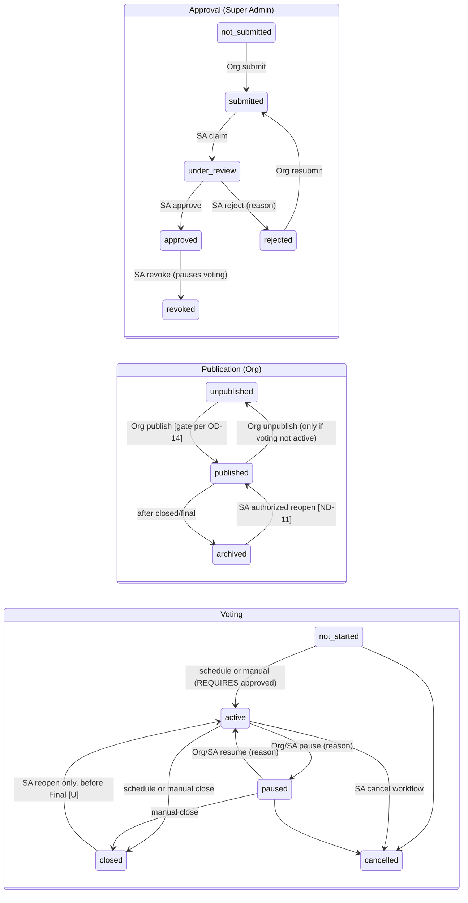

# TekVotes TAS v1.0 — Part 3 of 3
**Judging, Event Lifecycle, Operations, Domains, API, Jobs, Media, DevOps, Security, Load, Roadmap, Open Decisions** (TAS sections 15–26 + Traceability)

Labels: **[C]** confirmed · **[R]** recommendation · **[A]** assumption · **[U]** unresolved · **[V]** to verify externally.
Back: [Part 1](file:///C:/Users/Mac-Felix/.gemini/antigravity/brain/c8c783b0-b374-43e9-8dea-1725a0b5e7b4/TAS_v1.0_Part1_Foundation_and_Schema.md) · [Part 2](file:///C:/Users/Mac-Felix/.gemini/antigravity/brain/c8c783b0-b374-43e9-8dea-1725a0b5e7b4/TAS_v1.0_Part2_Security_Voting_Finance.md)

---

## 15. Judging, scoring, formulas, tie-breaking, finalisation [C Q10,26,37,38]

### 15.1 Flow
1. Category defines `scoring_mode` and `judging_criteria` (weights in bps summing to 10,000; scale min/max/step; required).
2. Judges assigned per category; they see **only** assigned category entries and criteria (**never** vote counts or other judges' scores during judging **[R]**; confirm **[U]**).
3. Judge works in a `draft` submission, then **submits** (`submit_scores`): validates required criteria and bounds, transitions to `submitted`, locks `judging_scores` (trigger forbids update/delete).
4. **Correction** after submit: requires `judging.correction.request` + approval by event owner/Super Admin with reason → creates a new `judging_submissions` row (`version = old.version + 1, supersedes_id = old.id`), marks old `superseded`.
5. **Public anonymity** [Q38]: when `judge.anonymous_public=true` (or category policy), public result views emit `Judge #k` or aggregate-only, never user identity.

### 15.2 Deterministic calculation (`scoring_rule_versions.definition`) [Confirmed OD-12]
Rule JSON specifies (with confirmed platform defaults):
- Criterion normalisation: `raw_to_100 = (score − min) / (max − min) × 100`.
- Judge score for entry: `J_j(e) = Σ_c (w_c / 10000) × norm(score_{j,c,e})`, averaged across submitted assigned judges `J(e) = avg_j(J_j(e))`.
- **Missing judge submissions** policy (Confirmed Default): `block_finalisation` — final result calculation cannot be published until all assigned judges have submitted required scores or an unsubmitted judge assignment is explicitly excused/revoked by the Organizer with an audit reason.
- **Public-vote normalisation** (Confirmed Default): `share_of_total` (`P(e) = (V(e) / ΣV) × 100`); zero-total edge case → `0`. (Category rule may optionally select `share_of_max` or `rank_points`).
- Combined: `Final(e) = (W_vote × P(e) + W_judge × J(e)) / 10000` using fixed-point `numeric(18,6)` with Half-Up rounding at the final step only.
- **Disqualified** entry: excluded before normalisation and recorded with `disqualified=true, rank=null`.
- **Tie-break order** (Confirmed Default sequence): `[higher_public_votes, higher_judge_aggregate, manual_committee_decision]`. Every tie resolution is written to `results.tie_break_trace`.

### 15.3 Finalisation and reopening [Confirmed OD-13]
`compute_results(category_id)` snapshots all inputs (ledger max id + hash of vote totals + submission ids) into `result_calculations(input_snapshot, input_sha256, rule_version_id)`. Re-running on the same snapshot yields identical output (pure function).
`publish_final(calculation_id)`: requires `voting_status='closed'`, all required judge submissions present, reconciliation clean for the event, and `event.results.publish` permission → sets category `results_state='final'`, writes `result_publications` and `leaderboard_snapshots`.
**Post-Final correction** **[Confirmed OD-13]**: requires **dual approval (Org Owner request + Super Admin approval)** + mandatory `correction_notice` shown publicly alongside the superseded publication.

---

## 16. Event lifecycle state machines [C 5.2–5.4, Q19,42,46,48,51]

Four orthogonal dimensions (stored separately, every transition logged in `event_status_history` with actor + reason):

- **Schedule enforcement**: `creditOrder`/`createOrder` check `now() < voting_closes_at` even if the cron job is late by seconds → closure is **exact to the timestamp**, while the cron updates `voting_status='closed'` and emits notifications.
- **Revoking approval** while `active` atomically sets `voting_status='paused'`.
- **Cancellation (Q51)**: freezes voting & settlements; creates an admin investigation case listing total collected, votes credited, settled vs held; Super Admin selects policy outcome (`full_refund_all` | `partial` | `no_refund_per_terms`) **[U OD-09]**; batch refund job executes.
- **Duplication (Q19)**: copies event metadata, categories, packages, criteria, branding, sponsors (optional), and optionally re-links contestant identities as `draft` entries — **never** votes, orders, payments, scores, journals, approvals (`approval_status` resets to `not_submitted`).

---

## 17. Notifications, moderation, fraud signals, exports

- **Notifications (Q21, 55, §11.1)**: transactional outbox table → worker sends via SMS/email/in-app; tracks delivery webhook status; idempotent per `(event_key, recipient, channel)`. **Receipts (Q21)**: all 4 channels — unique reference on screen, downloadable PDF/HTML receipt (signed URL or verifiable `/r/[reference]`), SMS (when phone present), email (when email present). **Announcements (Q55)**: only to recipients with `notification_preferences.opted_in=true` for `event_announcements`, audience-scoped to that event's voters/followers, rate-limited per event, logged with consent source **[U OD-19]**.
- **Moderation (Q54)**: public/voter form (rate-limited, challenge-protected) creates `moderation_reports`; triage queue for Event Mgr (profile issues) and Super Admin (fraud/vote manipulation); actions: dismiss, edit/hide media, pause entry or event voting, escalate to fraud investigation; all actions audited.
- **Fraud signals (§11.3)**: rules + anomaly jobs emit `fraud_flags(score, evidence)`: velocity spikes per entry, many phones on one device/IP, many cards/MoMo accounts on one device, high failed-payment ratio, repeated webhook replays, refund-after-close patterns. **Signals never auto-delete votes or auto-ban shared IPs [C]**; high scores can trigger step-up OTP, temporary rate throttle, or alert for human review + optional event pause.
- **Exports (Q44, §11.4)**: async job (`export_jobs`), checks permission **and** scope at request and at download; generates CSV / XLSX / PDF into private Storage with short-lived signed URL; logs row count, filter params, actor; redacts voter full phone/email for roles lacking PII permission (e.g. `23324***1234`).

---

## 18. Public URLs, domain resolution, white-label [C Q14,15,43,47,50,56]

- **Canonical routes**: `/` · `/competitions` · `/o/[orgSlug]` · `/e/[eventSlug]` (or `/o/[orgSlug]/[eventSlug]` — **[R]** globally unique event code `/e/[eventSlug]` plus org-scoped alias) · `/e/[eventSlug]/c/[entryCode]` (short link + QR code SVG/PNG generated server-side, cached on Cloudinary/CDN) · `/e/[eventSlug]/leaderboard` · `/e/[eventSlug]/results` · `/r/[orderReference]` (public receipt verifier showing masked payer + vote details). Slug changes write to `slug_history` and 301-redirect so printed QR codes never break.
- **Subdomains / custom domains (OD-16)**: Next.js middleware inspects `Host` header against cached `domains` lookup (Redis/edge cache + DB source of truth) → rewrites to `/_tenant/[orgId]/[eventId]/...`. Onboarding: org adds hostname → system issues DNS TXT ownership token + CNAME target → verifier checks DNS → calls hosting domain API (e.g. Vercel Domains API **[V plan/limits]**) to provision SSL → activates. Collision/takeover prevention: hostname unique across platform; re-verify periodically; reject apex/platform domains; strict `Host` allow-list prevents host-header poisoning.
- **White-label (Q47, 56, OD-15)**: theme tokens (`branding_settings`) drive CSS variables; whether "Powered by TekVotes" badge is removable is a flag `branding_settings.hide_platform_attribution` gated by platform approval **[U OD-15]**. Payment descriptor and legal merchant-of-record notice must remain truthful to the chosen payment model (**cannot** hide TekVotes on receipts if TekVotes is the merchant collecting funds **[V legal]**).

---

## 19. API route inventory (`/api/v1/...`, JSON, `Idempotency-Key` on mutations)

| Area | Endpoint | Method | Auth / Permission | Idempotent |
|------|----------|--------|-------------------|------------|
| Public | `/public/events`, `/public/events/[slug]`, `/public/entries/[code]`, `/public/categories/[id]/leaderboard`, `/public/receipts/[ref]` | GET | anon (RLS + cache) | — |
| Public | `/public/org-applications` | POST | anon + rate limit + challenge | key |
| Public | `/public/moderation-reports` | POST | anon/voter + rate limit | key |
| Voter | `/voter/otp/request`, `/voter/otp/verify` | POST | anon/guest, rate-limited | key |
| Voter | `/voter/orders` (create checkout) · `/voter/orders/[ref]` (status/receipt) | POST · GET | verified guest or registered voter | **required** |
| Voter | `/voter/me/history`, `/voter/me/favourites`, `/voter/me/preferences`, `/voter/refund-requests` | GET/POST/PATCH | registered voter (or verified phone lookup for refund request) | key |
| Webhooks | `/webhooks/paystack`, `/webhooks/sms`, `/webhooks/email` | POST | HMAC signature + allow-list | dedupe_key |
| Org | `/orgs/[orgId]` · `/orgs/[orgId]/members` · `/orgs/[orgId]/invitations` · `/orgs/[orgId]/roles` | CRUD | `organization.*` | key |
| Org finance | `/orgs/[orgId]/finance/summary`, `/transactions`, `/settlement-destinations`, `/settlement-requests` | GET/POST | `organization.finance.view` / `settlement.*` | **required** |
| Events | `/orgs/[orgId]/events` · `/events/[id]` · `/events/[id]/submit` · `/events/[id]/publish` · `/events/[id]/duplicate` | POST/PATCH | `event.*` | key |
| Voting ctl | `/events/[id]/voting/{pause,resume,close}` | POST | `event.voting.*` (reason required) | key |
| Catalog | `/events/[id]/categories`, `/packages`, `/limits`, `/sponsors`, `/branding`, `/entries`, `/entries/[eid]/managers` | CRUD | scoped `event.*` / `entry.*` | key |
| Judging | `/events/[id]/judges`, `/categories/[cid]/criteria`, `/categories/[cid]/scoring-rules` | CRUD | `event.judges.manage` | key |
| Judge portal | `/judge/assignments`, `/judge/submissions` (draft/submit) | GET/POST | `judging.score.submit` (assigned) | **required** |
| Results | `/categories/[cid]/results/calculate`, `/categories/[cid]/results/publish`, `/categories/[cid]/leaderboard-state` | POST | `event.results.publish` / `leaderboard.set_state` | **required** |
| Comms/Exports | `/events/[id]/announcements`, `/exports`, `/exports/[jid]` | POST/GET | `event.announcements.send` / `*.export` | key |
| Platform | `/admin/org-applications/[id]/{approve,reject}`, `/admin/events/[id]/{approve,reject,revoke,cancel}`, `/admin/commission-rules`, `/admin/vote-corrections`, `/admin/fraud-flags`, `/admin/domains` | POST/PATCH | `platform.*` | **required** |
| Finance admin | `/admin/finance/reconciliation/run`, `/admin/finance/refunds/[id]/{review,approve,reject}`, `/admin/finance/settlements/[id]/{finance-approve,super-approve,reject}` | POST | `finance.*` + SOD check | **required** |
| Media | `/media/upload-signature` | POST | any staff with media perm for target scope | — |
| Internal jobs | `/internal/jobs/[name]` | POST | cron secret / worker token | job key |

Standard error envelope: `{error:{code, message, details, request_id}}`. Every mutating handler writes `request_id` to `audit_logs`.

---

## 20. Background jobs, queues, schedulers

Using **Supabase `pg_cron` + `pgmq`** (or an external durable queue such as Upstash QStash/Inngest if worker runtimes exceed serverless limits **[R]**):
- `process_payment_webhook` (queue, immediate, retry w/ backoff, DLQ).
- `sweep_pending_payments` (every 2 min): verifies `payment_initiated` orders past grace age; expires stale `pending` orders.
- `scheduled_event_transitions` (every 1 min): flips `not_started → active` (if approved) and `active/paused → closed` when `voting_opens_at`/`voting_closes_at <= now()`. (Remember: runtime gates check timestamps directly, so this job is for state hygiene + notifications.)
- `refresh_leaderboard_snapshots` (debounced 2–5 s per active category when votes arrive).
- `dispatch_notifications` (outbox consumer, rate-governed per provider).
- `execute_approved_settlements` & `execute_approved_refunds`.
- `daily_reconciliation` + `nightly_ledger_and_tally_invariant_check` (pages on mismatch).
- `generate_export`, `verify_custom_domains`, `purge_expired_otps_and_exports`.

---

## 21. Cloudinary & media handling

- **Signed direct uploads**: client requests `/api/v1/media/upload-signature` with target `(org_id, event_id, entry_id, purpose)` → server checks permission, returns short-lived signed params restricting: folder `tekvotes/{env}/{org_id}/{event_id}/...`, allowed formats (`jpg,png,webp,avif`), max bytes, image dimensions, moderation/auto-orient flags. **Upload preset is signed; unsigned uploads disabled.**
- Server records only `public_id`, version, dimensions; delivery URLs built with safe transformations (`f_auto,q_auto,c_fill,…`). SVGs disallowed for user uploads (XSS vector) — QR SVGs are server-generated only.
- Sensitive org application documents go to **private Supabase Storage** (not public Cloudinary), accessed via short-lived signed URLs by Super Admin only.
- Deletion/replacement marks `contestant_media.deleted_at` and queues asset cleanup after retention window.

---

## 22. Environments, secrets, CI/CD, migrations, backups, monitoring

- **Environments**: `local` (Supabase CLI + Paystack mock/test), `staging` (isolated Supabase project, Paystack **test** keys, test SMS sink, separate Cloudinary folder/account, Vercel preview), `production` (isolated project, live keys). **Hard guard**: staging code rejects `sk_live_*` keys at boot.
- **Secrets**: stored in Vercel encrypted env + Supabase Vault where needed; `SUPABASE_SERVICE_ROLE_KEY`, `PAYSTACK_SECRET_KEY`, OTP HMAC pepper, webhook secrets never prefixed with `NEXT_PUBLIC_`; bundle-analyzer check in CI fails build if server modules are imported into client graph.
- **Database migrations**: declarative SQL in `/supabase/migrations`, applied only by CI after PR review + passing RLS & invariant tests; no manual dashboard schema edits in prod; destructive changes require expand-migrate-contract.
- **Backups & DR**: Supabase daily backups + **Point-in-Time Recovery (PITR)** enabled for production **[V plan tier requirement]**; additionally nightly logical dump of `fin.*`, `vote_ledger`, `audit_logs` to immutable object storage (WORM/retention lock). Quarterly restore drill to an isolated project verifying ledger balance + tally rebuild; define RPO/RTO targets **[U]**.
- **Monitoring & alerting**: structured logs (request_id, org_id, order_ref), Sentry error tracking, metrics & paging alerts on: webhook error rate or lag > 60 s, `paid_uncredited` > 0, reconciliation mismatch > 0, ledger/tally invariant failure (critical page), OTP spend spike, failed settlement transfer, 5xx spike.
- **Incident runbooks** (deliverables before launch): (1) global or single-event emergency voting pause, (2) Paystack webhook outage → switch to poll mode, (3) suspected vote manipulation → freeze results + audit query pack, (4) key rotation, (5) bad result publication → supersede & notice.

---

## 23. Threat model and security test plan

| Threat | Control | Test |
|--------|---------|------|
| Cross-tenant IDOR / privilege escalation | Composite FKs, RLS `has_perm`, server derives `org_id` from resource, delegation no-escalation trigger | Automated cross-tenant matrix (§7.5) + pentest |
| Fake / replayed payment or client redirect spoofing | Redirect never credits; HMAC webhook + mandatory server `verify()` API call; unique `(provider, provider_txn_id)` + `FOR UPDATE` | Replay webhook 50× concurrently; tamper amount/currency/ref; call callback URL without paying |
| Double credit / race on parallel webhook + poll | Single SQL fn, row lock on order, partial unique index on `vote_ledger(order_id) where credit`, unique journal `idempotency_key` | Parallel `creditOrder` stress test (100 threads, 1 order) → exactly 1 credit |
| Fractional or negative vote / price tampering | Snapshot at order creation; DB check `amount = votes * unit_price`, `votes > 0`; server ignores client price | Fuzz checkout with odd pesewa amounts, negative, float, stale package |
| Silent edit of votes, money, scores, final results | `REVOKE UPDATE/DELETE` + `BEFORE UPDATE OR DELETE` trigger raising exception | Attempt direct SQL update as service role → must fail |
| Collusion / unilateral payout | Dual-stage `settlement_approvals` with DB trigger `finance_approver ≠ super_approver ≠ requester`; destination re-verification | Try single-user dual approval in test → rejected |
| Judge sees others' scores or edits after submit | RLS to own `judge.user_id`; lock trigger on submit; corrections create new version | Judge token probes other submissions |
| Hidden leaderboard leakage | Public reads only `leaderboard_snapshots` where `published`; Realtime uses server Broadcast, not table replication | Subscribe to Realtime & query REST while `hidden` → 0 rows |
| OTP bombing / SMS drain / enumeration | Per-phone/IP/global budgets, human challenge before send, hashed codes, attempt cap, uniform responses | Rate-limit integration test |
| Device-limit bypass or shared-Wi-Fi false ban | Device/IP defaults to `flag` + risk score; hard limits on verified phone/account | Simulate campus NAT (100 voters, 1 IP, distinct phones) |
| XSS / SSRF / host-header / CSV injection | Sanitized rich text, no custom CSS, https-only social links, verified host allow-list, prefix `=+-@` escaped in CSV/XLSX | Security unit tests |

---

## 24. Load & performance strategy for high-volume voting

**Targets to confirm with owner [U ND-08]**: peak orders/sec, peak concurrent leaderboard viewers, largest contestant count per category.
Design for bursts (finale night):
- **Reads**: public event, entry and leaderboard pages served from edge cache / ISR (`s-maxage=2..5, stale-while-revalidate`) backed by the single `leaderboard_snapshots` row per category — **zero DB hits per viewer** for the cache window; Realtime Broadcast pushes small JSON diffs.
- **Writes (checkout & webhooks)**: stateless route handlers through **Supabase Supavisor transaction-mode pooler**; network calls (Paystack `verify`, SMS) happen **outside** DB transactions so connections are held for < 10 ms; webhook endpoint only validates + enqueues, workers drain at controlled concurrency so DB is never stampeded.
- **Hot contestant row**: `category_entry_tallies` receives one small update per *paid* transaction. If target > ~200 paid txns/s on a **single** contestant, enable 16-way sharded tally rows `(category_entry_id, shard int)` (`shard = hashtext(order_id::text) & 15`) summed by the snapshot worker — transparent to the rest of the schema.
- **Load test gate (Phase 8)**: k6/Artillery scenario simulating finale spike (checkout + concurrent webhook storm + 10k leaderboard viewers) must pass with 0 lost/duplicate credits and p95 < target before launch.

---

## 25. Phased implementation plan & architecture-to-launch mapping

Matches Handoff §15 Roadmap; **Gate 0 (this TAS + OD-01..07 resolution) must be signed off before Phase 2 coding starts**, and **OD-07 (Paystack/legal model) before Phase 5**.
Each phase ships with: migration + pgTAP RLS/invariant tests + API integration tests + audit-log assertions mapped 1-for-1 to the 27 Launch Acceptance Criteria in Handoff §16.

---

## 26. Decision & Validation Register (Updated with Confirmed Rulings)

### Resolved in TAS v1.0 (Locked for Implementation)
- **OD-07 (Architecture choice) [Confirmed]:** Option A — Central TekVotes Paystack collection + delayed payout after Finance Admin and Super Admin approvals. *(External provider/legal sign-off remains a mandatory pre-launch validation gate.)*
- **OD-01 / OD-02 [Confirmed]:** Pass Paystack fee as a transparent surcharge to Voter (`snapshot_surcharge_minor`); TekVotes commission calculated on the base vote amount (`snapshot_base_amount_minor`) with Half-Up rounding; Super Admin configures default and negotiated org rates in `commission_rules`.
- **ND-01 [Confirmed]:** 3-minute (180s) grace window after scheduled `voting_closes_at` for orders initiated before close; strict block (`paid_uncredited` → refund review) if voting is paused, cancelled, or a hard limit is breached.
- **OD-06 / ND-05 [Confirmed]:** Guest OTP verified once per 24h guest session (`httpOnly` cookie) with step-up OTP on high-risk signals; Registered voters verify phone once at signup.
- **OD-11 / ND-06 [Confirmed]:** `results_state` is per category; Live visibility mode is configurable per category by Organizer (`counts` default, `ranks_only`, or `percent`).
- **OD-12 [Confirmed]:** Normalize public votes (`% of category total votes × 100`) and judge scores (`0–100` scale); tie-break by (1) higher public votes, (2) higher judge score, (3) manual committee resolution; missing required judge scores block finalization unless excused.
- **OD-13 / ND-11 [Confirmed]:** Reopening or correcting `Final` results requires dual approval (Org Owner + Super Admin) with a mandatory public correction notice.
- **OD-14 / ND-07 [Confirmed]:** Organizers may publish "Coming Soon" event and contestant pages before Super Admin approves the event; the Vote button and order creation remain locked until `approval_status = 'approved'` (Q48).
- **OD-08 / OD-09 [Confirmed]:** Approved refunds reverse credited votes, deduct base share from Organizer balance, and proportionally reverse commission; non-refundable Paystack surcharge is not returned to the voter (or borne per policy).
- **ND-02 / ND-03 [Confirmed]:** Contestant identities are scoped per organization (`contestants.organization_id`); Contestant Managers are scoped per event entry (`contestant_entries.id`).

- **Funds holding & payout timing [Confirmed, owner ruling]:** platform (Super Admin) receives all voting funds; payouts to organizers (and refund execution) happen only after the event's voting ends; fund records are kept per event and per organization (Part 1 §3.8, Part 2 §12.0). *Open to confirm:* refunds after close (assumed), hold period after close, and whether settlement also needs final results published.

### Remaining Operational, Legal & Vendor Selections (Do Not Block Phase 2–4 Schema/Code)
1. **OD-07 (External Validation) [V]:** Obtain written Paystack & Ghana legal confirmation for central collection + delayed multi-org settlement before enabling live production payouts (Phase 5 exit criterion).
2. **OD-06 / OD-19 (Vendor Selection) [V/U]:** Select Ghana SMS/OTP vendor (e.g., Hubtel, Arkesel, mNotify, or Termii) and transactional email vendor (e.g., Resend, Postmark, or SES) and register Ghana sender ID.
3. **OD-03 / OD-05 / OD-08 (Policy Parameter Defaults) [U]:** Set exact initial numbers for default commission bps seed, min/max votes per order, minimum settlement withdrawal amount, and settlement reserve/hold days (all are data rows/columns in the schema, not hardcoded).
4. **OD-18 [V/U]:** Complete Ghana Data Protection Act review, privacy notice text, retention schedule, and minor-contestant guardian consent wording before launch.
5. **OD-15 / OD-16 / OD-17 / OD-20 [U]:** Phase 9 expansion policies (custom domain tier limits, white-label badge removal terms, multi-currency FX feed, and additional event-type templates).

---

## Appendix A — Traceability of all 56 confirmed decisions

| Q# | TAS section(s) | Q# | TAS section(s) | Q# | TAS section(s) | Q# | TAS section(s) |
|----|----------------|----|----------------|----|----------------|----|----------------|
| 1 | 3.4, 6, 19 | 15 | 3.5, 18 | 29 | 0.3, 3 | 43 | 3.6, 18 |
| 2 | 1.5, 4, 7 | 16 | 1.5, 1.6 | 30 | 3.5, 26 | 44 | 3.10, 17, 19 |
| 3 | 3.3, 6.3 | 17 | 3.3, 6 | 31 | 3.7, 8.1 | 45 | 3.1, 3.8 |
| 4 | 3.3, 3.6, 6 | 18 | 3, 11 | 32 | 2, 3.7, 9 | 46 | 3.5, 16, 20 |
| 5 | 3.6, 6, 7 | 19 | 3.5, 16 | 33 | 3.5, 3.7, 9.2 | 47 | 18 |
| 6 | 0.3, 2, 3.6 | 20 | 3.7, 8 | 34 | 1.5, 3.7, 19 | 48 | 3.5, 9.2, 16 |
| 7 | 3.5, 9.2 | 21 | 9.3, 17, 18 | 35 | 3.3, 3.6, 6 | 49 | 6.2, 19 |
| 8 | 3.5, 9.4, 17 | 22 | 3.5 | 36 | 3.6, 11 | 50 | 3.5, 18 |
| 9 | 2, 3.5, 13 | 23 | 3.8, 10.6 | 37 | 3.5, 13, 15 | 51 | 16 |
| 10 | 3.5, 15 | 24 | 3.7, 3.12, 13 | 38 | 3.9, 7.3, 15 | 52 | 0, 3.5 (no rounds) |
| 11 | 0.2, 10.2 | 25 | 3.5, 13, 14 | 39 | 3.4, 19 | 53 | 3.6, 23 |
| 12 | 3.8, 11 | 26 | 3.9, 15 | 40 | 3.5 | 54 | 3.10, 17, 19 |
| 13 | 0.3, 6, 7, 12 | 27 | 3.8, 11.2 | 41 | 2, 3.6 | 55 | 3.10, 17 |
| 14 | 18 | 28 | 0.3, 3.8, 6, 12 | 42 | 3.5, 16 | 56 | 0.3, 18 |
